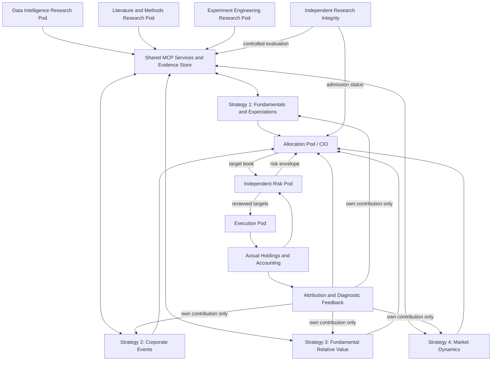

# Stochastic Pirates: Complete Pod Framework and Implementation Specification

**Version:** 1.1  
**Design date:** October 24, 2026  
**Audience:** The implementation team, investment researchers, and a collaborator who has not read the preceding conversations  
**Status:** Agreed architecture with proposed implementation defaults; not a claim of implemented functionality or validated investment performance

This document specifies an AI-assisted investment research and portfolio platform for the McGill–FIAM 2026 finals. It consolidates the team's latest design decisions into one implementation reference.

The platform has **four strategy pods**, separate **research specialist pods**, an **allocation pod**, an **independent risk pod**, and an **execution pod**. They share controlled MCP services, data infrastructure, experiment machinery, and evidence storage. Each role has a defined decision boundary.

The core operating principle is:

> Strategy owns investment beliefs. Research establishes what the evidence supports. Allocation owns target positions. Risk owns the permissible risk envelope. Execution owns the path from approved targets to actual holdings.

The investment objective is to produce stock-specific returns that survive realistic implementation at a compounding $1 billion and clear the competition benchmark of cash plus 4% per year.

The system must support broad discovery without pretending that broad access, many agents, or sophisticated models establish an investment edge. A useful outcome includes discovering that an attractive idea does not work.

**How to use this specification:** Read Sections 1–5 for the architecture and ownership. Use Sections 6–15 to build research/data services, Sections 16–20 to build the portfolio path, and Sections 21–27 for implementation contracts and acceptance. Section 29 separates official constraints, proposed defaults, and dependencies that still block a formation replay. Begin implementation with work packages W01–W07, then complete the vertical slice in Section 27 before adding research breadth.

**Version 1.1 addition:** Sections 20.10–20.20 specify the suggested language-model sets, why each is included, the actual cutoff evidence, model routing, and chronological switching. The models are candidates for task evaluation, not validated investment winners.

---

## Contents

1. [Scope, authority, and design commitments](#1-scope-authority-and-design-commitments)
2. [Competition mandate and success criteria](#2-competition-mandate-and-success-criteria)
3. [Organization and decision rights](#3-organization-and-decision-rights)
4. [The four strategy charters](#4-the-four-strategy-charters)
5. [Research specialists and research integrity](#5-research-specialists-and-research-integrity)
6. [Shared MCP platform](#6-shared-mcp-platform)
7. [Information universe and source discovery](#7-information-universe-and-source-discovery)
8. [Current Carbon Arc catalogue and verified limitations](#8-current-carbon-arc-catalogue-and-verified-limitations)
9. [Point-in-time data and identity](#9-point-in-time-data-and-identity)
10. [Academic papers and reusable methods](#10-academic-papers-and-reusable-methods)
11. [Economic reasoning and hypothesis composition](#11-economic-reasoning-and-hypothesis-composition)
12. [Research allocation and recurring improvement](#12-research-allocation-and-recurring-improvement)
13. [Experiment protocol and statistical integrity](#13-experiment-protocol-and-statistical-integrity)
14. [Model lifecycle and promotion](#14-model-lifecycle-and-promotion)
15. [Beliefs, uncertainty, and the bridge to returns](#15-beliefs-uncertainty-and-the-bridge-to-returns)
16. [Allocation and portfolio construction](#16-allocation-and-portfolio-construction)
17. [Independent risk management](#17-independent-risk-management)
18. [Execution and liquidity research](#18-execution-and-liquidity-research)
19. [Accounting and performance reporting](#19-accounting-and-performance-reporting)
20. [Agent behavior, isolation, and reproducibility](#20-agent-behavior-isolation-and-reproducibility)
    - [Suggested model sets, cutoff evidence, and switching](#2010-model-pool-and-routing)
21. [Contracts, schemas, and service responses](#21-contracts-schemas-and-service-responses)
22. [Storage, code organization, and orchestration](#22-storage-code-organization-and-orchestration)
23. [End-to-end operating cycles](#23-end-to-end-operating-cycles)
24. [Worked examples](#24-worked-examples)
25. [Failure handling and recovery](#25-failure-handling-and-recovery)
26. [Verification and acceptance criteria](#26-verification-and-acceptance-criteria)
27. [Build sequence and deliverables](#27-build-sequence-and-deliverables)
28. [Judge-facing evidence and demonstration](#28-judge-facing-evidence-and-demonstration)
29. [Configuration defaults and unresolved dependencies](#29-configuration-defaults-and-unresolved-dependencies)
30. [Sources and handoff checklist](#30-sources-and-handoff-checklist)

---

## 1. Scope, authority, and design commitments

### 1.1 What is being built

Build a research-to-portfolio system that can:

1. Discover relevant datasets, papers, methods, and economic mechanisms.
2. Form specific, falsifiable investment hypotheses.
3. Execute reproducible experiments with realistic timing and trading eligibility.
4. Distinguish business forecasting skill from return forecasting and portfolio value.
5. Promote useful models through a controlled lifecycle.
6. Combine distinct strategy forecasts without counting the same information repeatedly.
7. Construct, risk-check, and execute one coherent portfolio.
8. Diagnose why forecasts and trades succeeded or failed.
9. Explain any historical decision using the evidence available at the time.
10. Produce the competition's holdings file, statistics, exhibits, and agent counterfactual.

### 1.2 Authority order

Use this precedence:

1. Official finals instructions and subsequent official event amendments.
2. Explicit team decisions and frozen run configuration.
3. This implementation specification.
4. Earlier strategy documents and research notes.
5. Agent suggestions.

The public event website contains descriptions that differ from the detailed finals brief, including a reference to a global universe. The supplied finals PDF explicitly specifies U.S. equities. Implement the PDF's U.S. mandate unless the organizers formally amend it.

This document replaces the older pod charters as the implementation design. It does not alter, validate, or resubmit the existing first-round code, deck, or portfolio.

### 1.3 Agreed architecture versus proposed defaults

The following are design commitments:

- Four economic strategy mandates, listed in Section 4.
- Separate research, allocation, risk, and execution responsibilities.
- Shared data and methods through MCP interfaces.
- Private strategy research and independent final evaluation.
- Explicit, observable belief targets wherever feasible.
- Deterministic enforcement of portfolio constraints.
- Logged hypotheses, experiments, agent decisions, and model versions.
- Counterfactuals for material agent interventions.
- Broad source discovery with actual use governed by access, availability, and the mandate.

The following require implementation-time configuration before evaluation:

- Risk tolerances tighter than the official limits.
- Portfolio breadth within the allowed range.
- Research budgets and candidate quotas.
- Model families, lookbacks, refit schedules, and numerical promotion rules.
- Cost parameters and the treatment of missing market data.
- Agent models, release dates, and documented training cutoffs.

Every numerical default in this document is a proposed build choice unless explicitly identified as an official constraint or a directly inspected catalogue fact.

### 1.4 What a pod means

A pod is a logical responsibility with:

- A charter.
- An input/output contract.
- A private namespace where appropriate.
- A decision authority.
- A ledger.
- A measurable objective.

A pod does not require a permanently running language model or its own server. Multiple logical pods can run through the same worker pool. Agents are invoked for tasks requiring interpretation; routine calculations run in code.

---

## 2. Competition mandate and success criteria

### 2.1 Official constraints from the supplied finals brief

| Item | Requirement |
|---|---|
| Universe | U.S. public equities |
| Initial capital | USD 1 billion at the beginning of evaluation |
| Capital path | Compounds with realized portfolio performance |
| Evaluation period | January 2021 through August 2026 |
| Positions | 200–500 names, long and short combined |
| Gross exposure | At most 200% of current NAV |
| Net exposure | Between -50% and +50% of current NAV |
| Single-name exposure | At most 5% of current NAV in absolute value |
| Short eligibility | Market capitalization at least USD 500 million at formation |
| Decision frequency | Daily through monthly; justify the choice |
| Benchmark | Three-month U.S. Treasury bill rate plus 4% per year |
| Implementation language | Python |
| Final presentation | Ten minutes |
| Required submission | Presentation and dated holdings; exact upload format supplied at the event |

Market neutrality is an economic requirement in addition to the explicit gross and net limits. Dollar neutrality alone does not establish beta, sector, or factor neutrality.

### 2.2 Execution convention

For information dated through trading day `t`:

- The decision may form a book at the close of `t+1`.
- The first earned close-to-close return is from `t+1` to `t+2`.
- A feature using day-`t` returns cannot earn those same returns.
- Date-only events follow the convention even if they may have occurred before the open.
- Weekend and holiday handling must be explicit and tested.
- An observed announcement reaction can enter only after its full measurement window has closed, followed by the execution lag.

Dataset-specific publication delays are applied before deciding which information day the observation belongs to. Do not apply the same delay twice by confusing source availability with the mandatory execution lag.

### 2.3 What counts as success

Judge the platform on four separate dimensions:

1. **Forecast quality:** Does it predict the declared target better than an appropriate baseline?
2. **Investment quality:** Does the forecast identify executable residual returns?
3. **Portfolio quality:** Does the combined book improve after costs and under the mandate?
4. **Research quality:** Can another person reproduce the result and see all attempted alternatives?

A model may pass the first dimension and fail the others. The system must report that outcome rather than forcing it into production.

The cash-plus-4% hurdle is assessed on the fund. Do not subtract a full 4% separately from each pod's contribution and then sum the resulting contributions.

### 2.4 Research honesty

The team has already worked extensively with 2021–2026 data. A redesigned strategy evaluated on that period is not a fresh discovery holdout merely because its fitted parameters use earlier observations.

Maintain separate labels for:

- Chronologically valid parameter fitting.
- Previously seen historical evaluation.
- Truly untouched data, if any can be established.
- Prospective predictions committed before their outcomes.

Do not claim that short prospective tests establish portfolio Sharpe or information ratio. They can provide useful evidence about individual beliefs, timing, and operational behavior.

---

## 3. Organization and decision rights

### 3.1 Organizational map



Arrows represent permitted information flows, not permission to inspect another pod's private workspace.

### 3.2 Role boundaries

| Function | Responsible for | Cannot do |
|---|---|---|
| Strategy | Economic questions, hypotheses, interpretation, forecast publication | Set fund positions, override limits, inspect another strategy's private experiments |
| Data Intelligence | Source discovery, field semantics, identity, timing, coverage | Declare investment success from a catalogue or sample |
| Literature and Methods | Evidence retrieval, replication specifications, method implementations | Treat a paper's result as proof on our universe |
| Experiment Engineering | Implement and run registered experiments | Change specifications silently after seeing results |
| Research Integrity | Evaluation access, registries, admission decisions, audit | Generate favorable results for a preferred strategy |
| Allocation | Forecast integration, target holdings, pod risk budgets | Trade directly or overrule Risk's hard envelope |
| Risk | Independent exposure review, stress, limits, emergency policy | Rewrite a strategy's economic thesis or silently invent alpha forecasts |
| Execution | Order construction, timing, partial fills, trade-cost estimates | Invent a strategic view or change approved risk limits |
| Accounting | Positions, cash, fees, NAV, returns, attribution inputs | Substitute targets for actual holdings |

### 3.3 Central research support and strategy isolation

All strategies can discover the public/shared catalogue and reusable methods. A strategy may investigate any permitted dataset if it serves its economic charter.

Data rights are not hard-coded as “retail data belongs only to one strategy.” Access policies instead reflect licensing, historical eligibility, evaluation partitions, and role permissions.

Private items include:

- Unpublished hypotheses.
- Candidate features and trained models.
- Experiment feedback.
- Failed variants.
- Strategy forecasts before publication.
- Virtual books and position-level diagnostics belonging to that strategy.

Shared services run a strategy's work under its namespace. The backend authenticates the caller; an agent cannot gain access by supplying another `pod_id`.

Research Integrity sees experiment records across all strategies. Allocation sees published forecasts across all strategies. Risk sees the combined portfolio and authorized forecast context. Strategy pods do not receive each other's detailed results.

### 3.4 Corporate capital allocation versus portfolio allocation

Strategy 2 studies how companies finance themselves and deploy capital: issuance, buybacks, acquisitions, divestitures, and related decisions.

The CIO allocates the fund's capital and risk. These are separate responsibilities despite the shared word “allocation.”

### 3.5 Strategy count is a research structure, not a funding promise

Keep four charters available. Fund only admitted models whose aggregate contribution is defensible.

If one or two strategies survive validation, the active fund has one or two engines. Do not manufacture four active books to match an organization chart.

Research, risk, execution, and allocation are support and decision functions. Their outputs are not automatically additional alpha streams.

---

## 4. The four strategy charters

Each strategy starts with a broad economic question and can discover specific implementations. Examples below are candidate research topics, not preapproved trading rules.

### 4.1 Strategy 1: Business Fundamentals and Expectations

**Mandate:** Find changes in operating performance that investors underanticipate or incorporate incompletely.

**Economic questions:**

- Are sales, margins, customer behavior, or profitability changing?
- What can reasonably be predicted before the next disclosure?
- What portion of that change is already captured by public predictors?
- How does disclosed information propagate into expectations and prices?

**Research territory:**

- Earnings and revenue surprises.
- Guidance and revision activity where the fields exist.
- Demand nowcasts from spending, traffic, app activity, reviews, and software adoption.
- Pricing, promotions, inventory, hiring, and operating leverage.
- Pre-report forecasting and post-report adjustment.

**Potential targets:**

- Next reported revenue growth.
- Next reported margin change.
- EPS innovation relative to a specified public baseline.
- Probability of a verified beat/miss label.
- Residual return after a published earnings event.

**Target rules:**

- The target's resolution date is the actual release/acceptance time, not fiscal period end.
- A seasonal random-walk surprise is not analyst-consensus surprise.
- A report forecast and a post-report drift forecast are distinct models with distinct entry times.

**Indicative horizons:** Days to the next report; weeks after an announcement. Specific horizons are frozen per experiment.

**Cheapest baselines:** Seasonal persistence, existing panel surprise measures, a simple public-information model, and announcement reaction alone.

**Typical failure modes:** Correct business forecast already priced; alternative-data panel drift; delayed availability; earnings exposure duplicated elsewhere.

**Boundary:** Published earnings-reaction drift belongs here by default. Strategy 4 can investigate how temporary liquidity modifies its execution or payoff, with ownership declared in the trial register.

### 4.2 Strategy 2: Corporate Events and Capital Allocation

**Mandate:** Find discrete corporate decisions or disclosures whose economic consequences are underappreciated.

**Research territory:**

- Equity issuance and financing.
- Buybacks and capital returns.
- Acquisitions, divestitures, restructurings, and spin-offs.
- Management, auditor, or governance changes.
- Government awards and major contract events.
- Regulatory or legal events where data semantics are adequate.

**Potential targets:**

- Financing/dilution event within a declared interval.
- Change in share count or capital structure.
- Subsequent operating or balance-sheet effect.
- Residual return after a fully observed event.

**Required event interpretation:**

- Announced versus completed.
- Acquirer versus target.
- Gross authorized buyback versus actual repurchase.
- New contract obligation versus cumulative contract ceiling.
- New issuance versus an administrative filing.
- Materiality relative to the company's size and business.

An unsigned or ambiguous event label does not automatically supply a direction.

**Indicative horizons:** Days to months.

**Cheapest baselines:** Event indicator alone, size-normalized event magnitude, and sector/industry-matched event studies.

**Typical failure modes:** Ambiguous labels, double-counted contract modifications, action already anticipated, returns restricted to unshortable companies.

**Boundary:** A discrete financing event belongs here. Persistent earnings-quality or valuation deterioration belongs primarily to Strategy 3.

### 4.3 Strategy 3: Valuation and Fundamental Relative Value

**Mandate:** Find prices that misrepresent the quality, durability, or trajectory of future business economics.

**Research territory:**

- Mispriced growth or deterioration.
- Earnings quality and cash conversion.
- Balance-sheet resilience and financing fragility.
- Margin persistence and capital efficiency.
- Relative valuation among economically comparable firms.
- Businesses priced for an outcome that observable evidence does not support.

**Potential targets:**

- Future cash conversion or profitability persistence.
- Future investment efficiency.
- Deterioration in financing capacity.
- Residual medium-horizon return conditional on valuation and fundamentals.

**Required distinction:** A good company is not necessarily an underpriced stock. A cheap multiple is not itself proof of misvaluation.

**Indicative horizons:** Several weeks to several months. The final implementation must still comply with the permitted rebalance frequency.

**Cheapest baselines:** Sector-relative value, quality, profitability, and investment controls using the same tradable universe and costs.

**Admission standard:** Must establish value beyond simply repackaging those common styles. Existing historical failures of panel-based styles are evidence to consider, not a prohibition on all future research.

**Typical failure modes:** Generic factor exposure, value traps, poorly matched peers, insufficient independent observations, accounting incomparability.

**Boundary:** Strategy 1 predicts a coming business change; Strategy 3 asks whether the price appropriately values the business path and its sustainability. Shared inputs do not imply independent information.

### 4.4 Strategy 4: Market Dynamics and Information Diffusion

**Mandate:** Find temporary price pressure or slow transmission of information across securities.

**Research territory:**

- Short-horizon reversal and continuation.
- Liquidity shocks and unusual volume.
- Industry and economic-network lead–lag.
- ETF/index-related demand where the necessary data exists.
- Institutional ownership/crowding effects with correct publication dates.
- Temporary dislocations relative to economically justified peers.

**Potential targets:**

- Five- or twenty-day residual returns, with exact conventions specified.
- Persistence/reversal following a defined pressure event.
- Information transmission to firms that have not yet disclosed related outcomes.

Return targets are allowed for this strategy. Requiring every model to forecast fundamentals would artificially restrict its mandate.

**Indicative horizons:** Days to weeks.

**Cheapest baselines:** Lagged returns, sector/industry momentum, simple reversal, and liquidity-conditioned versions under identical costs.

**Typical failure modes:** Market microstructure artifacts, same-day return leakage, untradeable turnover, stale ownership snapshots, inferred flows mistaken for observed transactions.

**No-pretrained-model control:** Maintain at least one deterministic or conventionally fitted strategy implementation without an in-loop pretrained language model. An agent may help write audited code; that is different from an LLM producing historical signal values.

### 4.5 Shared ownership of economic mechanisms

Each hypothesis has:

- One primary strategy owner.
- An economic mechanism identifier.
- A source-family identifier.
- An event identifier where applicable.
- A forecast horizon.

Allocation uses these identifiers to detect multiple expressions of the same information. Do not assume that different pod names, normalizations, or datasets imply independence.

Do not gate all strategies on earnings proximity. The calendar is useful context; buybacks, financing events, and liquidity pressure can matter outside earnings windows.

---

## 5. Research specialists and research integrity

### 5.1 Data Intelligence Research Pod

**Objective:** Turn source documentation into reliable, discoverable economic measurements.

Responsibilities:

1. Catalogue sources, schemas, samples, and access status.
2. Answer the brief's four screening questions per asset.
3. Detect revisions, backfill, current-vintage mappings, and panel changes.
4. Evaluate historical company coverage and delisting coverage.
5. Maintain identity and economic-exposure links.
6. Propose measurements relevant to a strategy's stated gap.
7. Build reusable, audited data transformations.

Outputs include source cards, field cards, entity maps, coverage reports, and versioned feature datasets.

It may propose a candidate economic interpretation, but it cannot label a dataset “alpha-producing” based on metadata or samples.

### 5.2 Literature and Methods Research Pod

**Objective:** Make academic and practitioner research operationally useful.

Responsibilities:

- Search papers across disciplines.
- Retrieve available full text, appendices, code, and data descriptions.
- Extract mechanisms, target definitions, transformations, and assumptions.
- Find replications, contrary results, and post-publication evidence.
- Produce implementation specifications with exact source references.
- Maintain reusable methods with documented assumptions.

The library is not limited to finance. Marketing, operations research, accounting, economics, statistics, and sector-specific research may provide better models of business activity.

### 5.3 Experiment Engineering Research Pod

**Objective:** Convert registered ideas into reproducible computations.

Responsibilities:

- Build features from approved operators or reviewed extensions.
- Fit candidate models inside permitted partitions.
- Run baselines and matched comparisons.
- Generate diagnostics and artifacts.
- Record all run attempts, failures, configurations, and resource consumption.

It executes a specification. A methodological change after seeing results creates an amendment or new experiment; it does not silently overwrite the old one.

### 5.4 Independent Research Integrity

This function is separate from the specialists helping develop an idea.

Responsibilities:

- Own evaluation access.
- Maintain immutable experiment registration.
- Verify chronology, label maturity, and partition rules.
- Count attempted specifications and evaluations.
- Run controlled evaluation and challenge tests.
- Issue promotion eligibility decisions.
- Prevent agents from modifying the scoring rules or reading protected outcomes.

Most of this should be deterministic code. An independent reviewer agent can formulate challenges, but prose approval is not an admission decision.

### 5.5 Research allocator

Each strategy has a private research queue managed through a common scheduler.

The scheduler ranks work using:

- Economic importance of the unresolved gap.
- Evidence already available.
- Expected usefulness to that strategy.
- Data and implementation feasibility.
- Resource cost.
- Redundancy with work already attempted within the authorized namespace.

Start with explicit categories and quotas rather than a fitted optimizer for “research value.” Treat more adaptive scheduling as a later experiment with its own selection risks.

### 5.6 Reusable findings versus private discoveries

Shared:

- Field definitions.
- Timestamp corrections.
- Generic transformation implementations.
- Public literature.
- Verified data defects and provider limitations.

Private:

- A strategy's chosen feature combination.
- Its measured signal efficacy.
- Its candidate rankings.
- Its failed economic hypotheses.

Research Integrity can require a shared correction when a generic data defect affects all strategies. It must not disclose the private alpha idea that happened to uncover the defect.

---

## 6. Shared MCP platform

### 6.1 Design

Expose a small, stable tool surface backed by common Python services. MCP is the interface through which agents discover and request capabilities. It is not the authority for data eligibility, financial calculations, or portfolio limits.

The same backend functions should also be callable by deterministic orchestration and tests. Do not implement financial logic separately in an MCP server and in a backtest.

Use a gateway with:

- Authenticated role and namespace.
- Research clock and market-data clock.
- Dataset and evaluation-partition permissions.
- Input schemas.
- Output schemas and artifact references.
- Query limits, provider budgets, and cache policy.
- Correlation IDs linking tool calls to a hypothesis, experiment, or decision.

Load detailed tool groups on demand. Do not give every agent hundreds of almost identical dataset-specific tools.

### 6.2 Proposed tool families

The names below are **interfaces to implement**, not claims about tools already installed.

| Tool | Required inputs | Output |
|---|---|---|
| `catalog.search` | economic concept, optional sector/history filters | Ranked source/field candidates with evidence for the match |
| `catalog.describe` | source ID and snapshot ID | Source card, topic schemas, access status, unresolved questions |
| `catalog.sample` | source/topic, field selection, row bound | Schema-checked bounded sample; explicitly not a full-history claim |
| `catalog.propose_source` | source URL/identifier, purpose | Candidate source registration and connector work item |
| `data.coverage` | source, historical universe, interval | Coverage, missingness, exits, and identity-resolution diagnostics |
| `data.query_asof` | dataset version, information cutoff, entities, fields | Eligible observations plus provenance and availability metadata |
| `data.materialize_feature` | registered feature spec, interval, partition | Feature artifact ID, lineage, eligibility report |
| `identity.resolve` | identifier, identifier type, as-of date | Dated security matches, ambiguity status, evidence |
| `economy.related_entities` | entity, relationship type, as-of date | Dated relationships and confidence/materiality metadata |
| `papers.search` | query/mechanism, date ceiling, source filters | Deduplicated metadata and access status |
| `papers.read` | paper version, section/page range | Source-grounded text/equations with offsets |
| `papers.related` | paper ID, relation type | References, citations, replications, or related methods |
| `papers.replication_spec` | paper version, intended universe | Structured replication/adaptation plan with gaps |
| `methods.search` | target type, data shape, assumptions | Reusable method candidates and documented requirements |
| `methods.describe` | method version | Input contract, assumptions, baselines, implementation reference |
| `hypotheses.register` | complete hypothesis specification | Immutable hypothesis ID and content hash |
| `experiments.submit` | registered experiment, permitted partition | Asynchronous job ID |
| `experiments.status` | job ID | State, progress, artifacts, typed failure if any |
| `experiments.compare` | registered comparison ID | Paired baseline/challenger report under the approved policy |
| `diagnostics.forecasts` | own model/version, matured interval | Calibration, error structure, coverage and event diagnostics |
| `diagnostics.contribution` | authorized strategy/run, interval | Own contribution and implementation diagnostics |
| `memory.search` | own namespace, semantic query | Prior evidence, failures, amendments, unresolved gaps |
| `forecasts.publish` | admitted model version, forecast batch | Validated immutable publication ID |
| `portfolio.propose` | published forecast set, current holdings | CIO target artifact and construction diagnostics |
| `risk.review` | proposed/actual book, risk snapshot | Limit results, stress, review decision, remedy constraints |
| `execution.plan` | reviewed target, actual book, liquidity snapshot | Orders, schedules, expected costs, unresolved feasibility |
| `decisions.explain` | position/decision/date | Evidence-linked historical decision dossier |

Separate service ownership from tool visibility. For example, a strategy may request its diagnostic report but cannot invoke CIO allocation with arbitrary rival forecasts.

### 6.3 Trusted request context

Inject this context from the host, never from untrusted agent arguments:

```json
{
  "caller_role": "strategy",
  "namespace": "strategy_1",
  "run_id": "run_example",
  "research_asof": "2020-12-31T23:59:59Z",
  "allowed_partitions": ["design"],
  "data_policy_version": "policy_example",
  "hypothesis_id": "hyp_example",
  "request_id": "request_example"
}
```

If a requested paper, observation, outcome, or artifact falls outside the context, the backend returns a typed denial. The agent cannot override the context by putting a later date in a tool argument.

### 6.4 Tool response envelope

All tools return:

- `status`: `success`, `warning`, or `error`.
- `summary`: short factual result.
- `artifacts`: stable IDs, hashes, media types, and storage references.
- `provenance`: versions, timestamps, provider, and lineage.
- `limitations`: missing fields, coverage limitations, or other material uncertainty.
- `next_actions`: permitted follow-ups.
- `error`: typed code, retryability, and stop condition when relevant.

Large data returns as an artifact, not thousands of rows in the LLM context.

A warning is not permission to use ineligible data. Eligibility is a separate machine-readable property.

### 6.5 Job execution and idempotency

Research runs can take minutes or hours. Submission returns a job ID immediately.

An idempotency key includes:

- Registered experiment hash.
- Data snapshot.
- Code/method version.
- Model configuration and seed.
- Partition and clock policy.

An identical completed request returns the stored artifact. A changed input creates a new run linked to the existing specification.

Log failed and cancelled jobs. A failed infrastructure attempt is distinct from a tested investment variant, but neither disappears from the operational record.

---

## 7. Information universe and source discovery

### 7.1 Discovery should start from a concept

A strategy should be able to ask:

> “What permitted measurements could reveal deteriorating customer economics before reported margins change?”

The catalogue searches descriptions, field definitions, entity types, topics, historical coverage, and known joins. Its response should explain why each candidate is relevant.

Search dimensions:

- Economic concept: demand, pricing power, financing pressure, churn.
- Business model: subscription, retail, regulated bank, commodity producer.
- Entity: company, brand, product, location, merchant, fund, security.
- Measurement: count, amount, rate, event, text, relationship.
- Frequency and expected lag.
- Historical coverage and vintage evidence.
- Sector/geographic applicability.
- Relationship to existing public predictors.

Use keyword and semantic retrieval together. An embedding match is a discovery aid, not verification that the field measures the desired concept.

### 7.2 Information families

| Family | Examples | Potential use |
|---|---|---|
| Fundamentals | Financial statements, KPIs, cash flow, segments | Business forecasts, earnings quality, relative valuation |
| Expectations | Consensus, revisions, guidance, forecast dispersion | Measure anticipated versus unexpected outcomes |
| Ownership | 13F, 13D/G, fund holdings, common owners | Concentration, neglect, institutional positioning |
| Flows | ETF creations/redemptions, fund flows, index changes | Mechanical demand and potential price pressure |
| Insiders/governance | Form 4, management changes, votes, compensation | Alignment, governance transitions, event interpretation |
| Shorting constraints | Borrow cost, utilization, recalls, short interest | Short eligibility, implementation risk, crowding |
| Derivatives | Option prices, skew, term structure, open interest | Uncertainty and positioning proxies |
| Credit/capital structure | Debt prices, maturities, refinancing, issuance | Financing fragility and credit/equity disagreement |
| Demand | Card spend, traffic, transactions, app usage | Revenue and customer behavior |
| Supply/operations | Inventory, job openings, capacity, shipping | Cost, execution, and operating constraints |
| Competition | Pricing, reviews, adoption, market share | Relative business trajectory |
| Relationships | Customers, suppliers, products, shared ownership | Economic exposure and information diffusion |
| Innovation | Patents, launches, developer activity, clinical events | Product cycles and future demand |
| Legal/regulatory | Litigation, approvals, procurement, policy | Discrete changes in business economics |
| External conditions | Rates, FX, commodities, weather | Company-specific sensitivity and stress |
| Market activity | Returns, volume, spreads, auctions | Liquidity, repricing, and temporary dislocations |
| Attention/narrative | News, transcripts, search, disclosures | Information arrival and changes in interpretation |

These are research territories. Do not create a top-level strategy pod for each family.

### 7.3 Source lifecycle

Use explicit source states:

```text
DISCOVERED
  -> DOCUMENTED
  -> SAMPLED
  -> ACCESS_CONFIRMED
  -> HISTORICALLY_ASSESSED
  -> APPROVED_FOR_RESEARCH
  -> APPROVED_FOR_FORMATION
```

Alternative outcomes:

- `UNAVAILABLE`: no access or no required history.
- `DESCRIPTIVE_ONLY`: useful context, insufficient point-in-time evidence.
- `QUARANTINED`: schema, identity, or revision problem.
- `RETIRED`: source stopped updating or changed incompatibly.

Approval is metric/topic specific. One valid table does not automatically approve every field in the dataset.

### 7.4 Broad discovery and competition data policy

The general platform can discover sources beyond the current catalogue. Actual competition features must follow the team's official-data-only policy unless the organizers and team explicitly establish a permitted expansion.

Academic literature access is a research service. Reading a paper does not authorize importing its proprietary or otherwise non-permitted market dataset.

Record a source gap rather than inventing a proxy with the original source's name. A proxy can be researched if its limitations and actual target are declared.

### 7.5 ETF flows and ownership interpretation

For ETF research, distinguish:

- Exchange trading volume in ETF shares.
- Changes in ETF price or NAV.
- Changes in shares outstanding.
- Primary-market creations/redemptions.
- Underlying baskets or fund holdings.

An approximation such as change in shares outstanding multiplied by NAV estimates net creation/redemption value after adjusting for splits and reporting conventions. It is not a direct record of all underlying stock transactions.

A stock-level pressure estimate also needs dated holdings/baskets, liquidity, and a documented mapping. Label inferred pressure as a proxy.

For 13F:

- Quarter-end holdings are disclosed later, generally within 45 days.
- Eligibility starts at actual publication, not at quarter-end.
- Short positions are not reported.
- Held options are not a complete options book.
- Amendments, confidential treatment, identifier changes, and duplicate managers require handling.
- A change in reported value is not necessarily buying or selling; use shares and corporate-action adjustments where possible.

The filing date is not the trade date. A missing or literal “Latest Filing” date is unusable for historical formation until resolved.

---

## 8. Current Carbon Arc catalogue and verified limitations

### 8.1 Snapshot inspected for this design

Archive: `carbonarc_library_2026-10-24.zip`.

SHA-256:

```text
5b7b624282c89c475e2aac56533de8db89e06ece71422a64bab9a2ef0a162874
```

Directly inspected archive inventory:

| Content | Count |
|---|---:|
| Catalogue entries | 625 |
| Data dictionary CSV files | 621 |
| Sample XLSX files | 299 |
| Webcontent catalogue entries | 549 |
| Demand entries | 40 |
| Supply entries | 17 |
| Reference entries | 10 |
| Logistics entries | 9 |

Entry counts, dictionary counts, and sample counts have different grains. Some identifiers are grouped in one catalogue entry. Build a manifest rather than inferring missing coverage from arithmetic alone.

This archive is documentation and samples. It does not establish entitlement, complete historical extracts, historical universe coverage, or reconstruction of past vintages.

### 8.2 Candidate source map

“Listed history” below is the catalogue statement, not independently validated history.

| ID | Source | Listed history / inspected content | Initial treatment |
|---|---|---|---|
| CA0035 | Benzinga Financial News & Data | 2011–present; event-topic dictionaries | Candidate event data; verify labels, clocks, and coverage |
| CA0032 | Financial Filing Forms | Filing/XBRL dictionary, acceptance timestamp | Quarantine mismatched sample; verify actual extract |
| CA0065C | Company Reported Actuals | 2015–current; statement/KPI samples | Candidate fundamentals; establish release timing |
| CA0056 | U.S. card complete panel | 2019–present; restated/reweighted panel description | Revision and composition checks required |
| CA0058 | Health spend | 2017–present; transaction, knowledge, publication fields | Distinguish clocks and backfill before use |
| CA0058G | Private-label card panel | April 2015–present | Candidate long-history spending source |
| CA0060 | Foot traffic | 2019–present | Candidate demand measure; short-history treatment |
| CA0030 | Clickstream | 2020–present | Short-history and vintage checks |
| CA0052 | Brand reviews | 2013–present | Check edited reviews and historical capture |
| CA0043A | Job openings | 2017–present | Candidate labor/expansion measure |
| CA0097J | U.S. job postings | 2010–present; no sample found in this archive | Documentation-only candidate until sampled |
| CA0043C | Software customers | 2016–present; product/technology and company fields | Resolve economic meaning and timing |
| CA0093 | SaaS Market Dynamics | 2011–present; contracts/spend/consumption samples | Promising business-economics source; vintage still unresolved |
| CA0098 | Open-source activity | Multiple histories by topic | Assess each topic and entity mapping separately |
| CA0069G | Government contracts | 2001–present; awards and modification semantics | Deduplicate and separate new obligations from totals |
| CA0069B | Global trade flows | 2015–present; buyer/seller description | Candidate economic-network source |
| CA0051 | FFIEC bank reporting | 2000–present | Candidate sector-specific research input |
| CA0077 | Commodity metrics | 1990–present | Candidate cost/exposure context |
| CA0092 | Securities ratings | Block 2016–present; aggregated 2017–present | Baseline/vendor feature, not assumed novel alpha |
| CA0099 | Adviser profiles / 13F | ADV 2015–present; 13F January 2024–present | Late-start ownership source with filing-date checks |
| CA0084_466 | Edgar 13f webcontent | May 2026–present | Very short-history research lane |

### 8.3 Specific inspected issues

1. **CA0032 schema mismatch.** Its dictionary describes filing facts including acceptance time. The sample workbook labelled CA0032 contains a sheet named “Company Reported Actuals,” with sales/cost/profit fields. Do not infer that those sample rows are filing facts or that usable filing text is available.
2. **No filing-text field established from the inspected CA0032 dictionary.** The official brief describes filing text. The exact accessible endpoint/topic must be reconciled before building a text channel.
3. **Health-spend clocks differ.** One inspected row has a 2017 transaction/knowledge date and a 2025 publication timestamp, with a backfill partition. Determine what each date means; a historical transaction date alone does not establish historical feature eligibility.
4. **Software-customer dates require interpretation.** An inspected sample has a date preceding its maximum detection date. A period summary cannot be used before its constituent observations were knowable.
5. **Government contract fields have different meanings.** Incremental obligations, estimated per-awardee amounts, and final cumulative contract values are not interchangeable. A “latest row” flag can incorporate later lifecycle information.
6. **13F filing dates can be non-dates.** CA0099's dictionary explicitly allows “Latest Filing.” Historical models must reject unresolved records.
7. **CA0065S stock prices was not found in this catalogue snapshot.** Confirm official access or another permitted price/volume source.
8. **No dedicated numerical ETF-flow, borrow/loan, or option-chain source was identified in the catalogue search.** Benzinga topics are not substitutes for those numerical histories.

### 8.4 Data ingestion deliverable

Before using a source, write a machine-readable source card and a short assessment containing:

- Topic and field names actually observed.
- Sample and documentation hashes.
- Extract endpoint and entitlement.
- Earliest usable observation after vintage assessment.
- Historical company/security coverage.
- Publication and platform-delivery timing.
- Revision/backfill treatment.
- Permitted entity joins.
- Source-specific failure conditions.

---

## 9. Point-in-time data and identity

### 9.1 Keep the clocks separate

Every observation can have several times:

| Field | Meaning |
|---|---|
| `event_time` | When the economic activity occurred |
| `period_start/end` | Accounting or aggregation interval |
| `source_published_at` | When the source publicly released the information |
| `vendor_known_at` | When the vendor first knew the observation, if established |
| `platform_delivered_at` | When the platform made it available |
| `ingested_at` | When our system downloaded it |
| `valid_from/to` | Period during which an identity or relationship is true |
| `version_known_at` | When this version or revision became available |
| `formation_at` | When our approved position begins |
| `label_resolved_at` | When the forecast outcome becomes observable |

All timestamps use UTC internally, with source timezone and trading-session interpretation preserved.

### 9.2 Availability is evidence-based

Define `available_at` per metric and vintage from the documented dissemination process.

For historical source-publication eligibility, a later local download is not automatically a leak if the exact historical information can be independently reconstructed. Conversely, a backfilled current value is not historically eligible simply because it carries an old event date.

Store:

- The declared availability rule.
- The evidence supporting it.
- Revision completeness.
- Earliest admissible time.
- Whether use is source-publication historical, platform-delivery historical, or descriptive only.

The Benzinga historical baseline follows source publication under the brief. A separate weekly-delivery variant measures live-platform feasibility.

### 9.3 Bitemporal storage

Store both:

1. The economic time the row describes.
2. The time this version became known.

An as-of query must select the latest eligible version at the requested cutoff, not the latest version in the database.

Conceptual predicate:

```python
eligible = (
    observation.available_at <= information_cutoff
    and observation.version_known_at <= information_cutoff
    and identity_link.valid_at(observation.event_time)
)
```

The exact predicate depends on the source card. A filing's first-reported value and a later restatement are separate observations, not one overwritten cell.

### 9.4 Lagged monthly characteristics

Monthly panel labels do not necessarily equal publication dates.

- Use the panel's documented characteristic availability convention.
- Do not assign a month-end accounting value to every earlier day of that month.
- Carry eligible observations forward only after their availability time.
- Keep age/staleness metadata.
- Use daily prices, returns, and liquidity measures only where those fields actually exist.

Normalize units at ingestion: market equity reported in millions, shares reported in thousands, share volume, dollar volume, and signed-price conventions must be converted according to the source documentation. Preserve raw values and conversion rules. A USD 500 million threshold cannot be applied directly to a field stored in millions without conversion.

### 9.5 Security master

Use an internal stable `security_id`, with dated links to:

- PERMNO where supplied.
- CIK.
- Ticker and exchange.
- Share class.
- Company/issuer ID.
- Brand/product entities where relevant.
- Corporate-action and listing history.

CIK identifies a filer, not necessarily one unique tradable share class. PERMNO/ticker/CIK mappings can be one-to-many. Resolve security class and date explicitly.

Never join a long historical series on today's ticker map.

### 9.6 Entity resolution policy

Resolution states:

- `EXACT_DATED`.
- `REVIEWED_DATED`.
- `AMBIGUOUS`.
- `UNRESOLVED`.

Do not convert an agent's plausible guess into an exact match.

A mapping proposal contains source identifiers, candidate securities, validity interval, evidence, confidence, and review status. Ambiguous records stay out of formation until resolved.

Test product/brand materiality separately from identifier correctness. Correctly mapping a subsidiary to its parent does not establish material investment relevance.

### 9.7 Economic exposure graph

Edges include:

- Owns brand/product.
- Supplies/customer of.
- Competes with.
- Operates location.
- Exposed to input commodity.
- Held by fund/ETF.

Each edge stores:

- Validity interval.
- First-known timestamp.
- Source evidence.
- Relationship direction.
- Weight/materiality if supportable.
- Confidence and uncertainty.

A relationship with no historical date is descriptive until a defensible historical rule exists.

### 9.8 Survivorship and coverage

Before feature testing:

1. Attempt to resolve known 2017–2020 exits named in the brief.
2. Extend to historical exit cohorts, not just a handful of examples.
3. Compare coverage by sector, size, liquidity, age, and exit status.
4. Test whether coverage/missingness alone predicts subsequent returns.
5. Compare covered versus uncovered names with suitable controls.
6. Inspect whether mapping uses a present-day universe.

A covered-only comparison can reduce a specific comparison bias. It cannot recreate missing failures or make survivor-only training representative of all historical firms.

The supplied 8-K corpus has an officially acknowledged survivorship defect. Any use must state its limitations and show the chosen treatment.

### 9.9 Missing returns and delistings

Do not drop held names because their next return is missing. Do not assume a free, immediate liquidation at the last observed price.

The engine needs an explicit policy for:

- Ordinary missing days.
- Trading halts.
- Corporate actions.
- Delistings and settlement.
- Missing terminal stub returns.

If permitted data does not establish the terminal economic outcome, place the position in an unresolved/suspense state, apply a declared conservative accounting/stress policy, and report sensitivity. Do not claim exact historical NAV where a material terminal return is unknown.

No new trade can rely on a price whose staleness exceeds the configured rule.

### 9.10 Per-join checks

Every materialization must verify:

- Feature availability precedes the decision cutoff.
- Identity links are valid at the relevant time.
- Source versions are approved for the partition.
- Aggregation windows end before availability.
- Training labels had resolved before the training cutoff.
- A late-start source is absent before its permitted start.

Store these assertions as an eligibility report beside the artifact.

---

## 10. Academic papers and reusable methods

### 10.1 One paper interface, several backends

Implement `papers.*` as an internal interface that can use:

| Backend | Role | Access distinction |
|---|---|---|
| OpenAlex | Broad discovery, citations, references, metadata | Official MCP documented; API access also available |
| arXiv | Preprints, versions, metadata, available content | Official API; community MCP adapters are available |
| Semantic Scholar | Discovery, related papers, citation graph, recommendations | API; content availability differs by paper |
| Crossref | DOI resolution and bibliographic metadata | Metadata does not imply full-text access |
| Unpaywall / repositories | Locate available open-access copies | Respect actual access and reuse terms |
| SSRN, NBER, RePEc, author pages | Economics/finance discovery and available working papers | Do not assume a universal full-text API |
| Local paper library | Papers and appendices supplied by the team | Record provenance and permitted use |

Verified examples at design time:

- OpenAlex MCP: `https://mcp.openalex.org/mcp`.
- arXiv official API documentation: `https://info.arxiv.org/help/api/user-manual.html`.
- Community arXiv MCP example: `https://github.com/blazickjp/arxiv-mcp-server`.

These are integration options. This document does not install them or certify a third-party implementation. Verify current authentication, budgets, schemas, and repository behavior during implementation.

### 10.2 Paper retrieval pipeline

1. Search the mechanism, not only a proposed signal name.
2. Resolve identifiers and deduplicate versions.
3. Preserve preprint, journal, revision, and correction dates.
4. Obtain full text and appendices when available.
5. Extract section/page references.
6. Locate code, data definitions, and implementation notes.
7. Follow references and later replications or contrary evidence.
8. Create a paper card.
9. Create a replication/adaptation specification.
10. Run experiments through the normal registry and evaluator.

An abstract alone is insufficient to implement a method accurately. If equations, definitions, or appendices cannot be obtained, mark the implementation incomplete rather than filling gaps from memory.

### 10.3 Paper card

Store:

- DOI, arXiv ID/version, and other source IDs.
- Title, authors, publication and first-public dates.
- Source URL and content hash.
- Access status: metadata-only, abstract, full text, appendix, code.
- Economic claim and proposed mechanism.
- Original universe, period, target, and horizon.
- Exact variable definitions and timing.
- Statistical design and comparison baseline.
- Parameters fixed by the paper.
- Parameters requiring estimation.
- Known replications, contrary evidence, corrections, and limitations.
- Sections/pages supporting each extracted statement.

### 10.4 Replication versus adaptation

Use separate labels:

- `EXACT_REPLICATION`: same operational definitions and sufficiently equivalent inputs.
- `CLOSE_REPLICATION`: documented deviations with a comparison plan.
- `MECHANISM_TRANSFER`: same economic explanation, different measurements or universe.
- `METHOD_TRANSFER`: same statistical method applied to a different economic target.
- `INCOMPLETE`: required details or inputs missing.

Do not call a result an exact replication when consensus is replaced with a seasonal baseline or a stock universe is replaced with a narrow vendor-covered subset.

### 10.5 Literature eligibility and research time

Two honest modes are supported:

**Contemporary research mode:** The team uses today's literature to design a model now, then labels historical evaluation as retrospective and/or uses a future committed evaluation.

**Historical discovery replay:** At research date `D`, the simulated research engine can see only paper versions and outcomes available by `D`.

Do not mix the modes. A modern LLM's memory remains a limitation even when the retrieval layer filters publication dates.

Version-specific paper content matters: a 2017 preprint identifier does not authorize using a 2025 revision's discoveries in a 2017 replay.

### 10.6 Reusable method registry

A method card contains:

- Method ID and version.
- Supported targets and data shapes.
- Minimum history and effective-sample requirements.
- Assumptions about stationarity, missingness, and dependence.
- Training and prediction interfaces.
- Hyperparameter search space and trial cost.
- Computational requirements.
- Reference implementation.
- Meaningful tests and expected failure modes.
- Baselines the method must be compared against.

Initial candidate classes may include:

- Seasonal persistence and simple regressions.
- Regularized linear models.
- Small tree/boosting models where supported by sample size.
- Forecast combinations with shrinkage.
- Survival/event-hazard models for suitable event targets.
- Panel and hierarchical models.
- Time-series/state-space methods where economically justified.
- Text extraction/classification when the text and timing are verified.

Do not require a complex model merely because a registry exposes it.

### 10.7 Watches and updates

Support topic watches by strategy, mechanism, target, and method.

A new paper creates a research-queue item. It does not automatically replace a production model or reopen a final holdout.

Cache metadata and documents centrally; keep strategy-specific interpretations and experiment feedback private.

---

## 11. Economic reasoning and hypothesis composition

### 11.1 The hypothesis is the unit of research

Every hypothesis must specify:

1. The economic question.
2. The expected source of mispricing or predictable price pressure.
3. The observable target.
4. The proposed feature or relationship.
5. The applicable companies and business models.
6. The availability rule and entry convention.
7. The expected horizon and resolution.
8. The simplest competing explanation.
9. The falsification condition.
10. The proposed experiment and declared comparison.

Reject proposals that only say “use AI to find patterns.”

### 11.2 Reasoning modes

Strategies can generate ideas through:

- **Literature replication:** reproduce a published finding.
- **Mechanism transfer:** apply a known explanation to a new permitted measurement.
- **Error diagnosis:** investigate a systematic failure of the current model.
- **Contradiction:** investigate disagreement between economically related sources.
- **Cross-source composition:** combine measurements linked by a specified mechanism.
- **Peer transmission:** use dated information from related companies.
- **Measurement improvement:** fix an inadequate proxy or stale mapping.
- **Method improvement:** test whether another forecasting approach handles the known problem better.

Every route uses the same registry and evaluation rules.

### 11.3 Economic-disagreement laboratory

Useful disagreements include:

- Traffic increasing while spending per visit falls.
- Customer adoption rising while paid-license utilization declines.
- Contract awards increasing while operating capacity remains constrained.
- Reported earnings rising while cash conversion deteriorates.
- Fundamental conditions improving while the stock reprices negatively.

For each disagreement:

1. Check that sources measure comparable entities and periods.
2. Check sampling and normalization.
3. List at least two plausible explanations.
4. Identify what would distinguish them.
5. Test a small, explicit feature or interaction.
6. Compare with each component separately.
7. Test forecast quality and executable return translation.

A disagreement may reveal a data problem rather than an investment opportunity. That is a useful research outcome.

### 11.4 Cross-source composition

Use economic relations rather than arbitrary exhaustive combinations.

Example:

```text
Hypothesis:
Higher traffic plus lower spending per visit and deeper promotions
predicts weaker margins than a traffic-only demand forecast.

Mechanism:
Discounting can purchase volume while reducing profit per transaction.

Minimum comparison:
Traffic-only model vs spending-only model vs combined mechanism model.

Failure:
The interaction adds no stable predictive information, or the effect is
explained by changes in source panel composition.
```

Register the interaction before scoring it. Testing several lookbacks, transformations, target definitions, or sector filters creates several variants.

### 11.5 Sector and business-model applicability

Sector expertise belongs inside strategy mandates.

The same feature can mean different things:

- Inventory growth in retail versus a build-to-order industrial.
- Hiring in a subscription software company versus a staffing provider.
- Revenue growth in a regulated bank versus a consumer merchant.

Use declared applicability masks and economic peer groups. Do not fill missing native-domain forecasts with a broad-domain fallback unless transfer is independently registered and evaluated.

### 11.6 A reviewed feature language

Start with a compact set of causal operations:

- Lag, difference, growth, seasonal change.
- Rolling mean/dispersion using past observations.
- Within-date rank or standardization.
- Exposure normalization, shares, and rates.
- Event counts and time since an event.
- As-of joins.
- Dated peer aggregates.
- Conditional interactions.
- Missingness/staleness diagnostics.

Feature construction must preserve availability metadata.

The proposal agent emits a structured specification, not an unrestricted scoring script. New operators and methods can be added through reviewed extensions with tests. This permits expansion without allowing an agent to bypass the broker or evaluator.

### 11.7 Required negative evidence

Every serious candidate needs a record of:

- Its strongest simple baseline.
- A competing economic explanation.
- Timing sensitivity.
- Coverage sensitivity.
- Cost sensitivity.
- Incremental contribution versus the current authorized baseline.

The challenge is substantive. A second agent saying “looks sound” is not negative evidence.

---

## 12. Research allocation and recurring improvement

### 12.1 Scheduled and triggered reviews

Use a recurring research review, plus triggers:

- A sufficient cohort of forecasts resolves.
- A new eligible source or paper becomes available.
- Calibration deteriorates beyond a preregistered condition.
- Data coverage or field meaning changes.
- Implementation consumes the expected payoff.
- A strategy's own contribution becomes redundant or concentrated.

The initial cadence should be configurable; weekly queue review and monthly resolved-cohort review are reasonable build defaults, not validated optimal schedules.

Do not retrain or redesign automatically after every loss.

### 12.2 Failure taxonomy

| Observed problem | Research question |
|---|---|
| Target forecast is wrong | Missing measurement, wrong relationship, or inadequate method? |
| Target forecast is right, returns are absent | Already priced, wrong horizon, or wrong return bridge? |
| Gross returns work, net returns fail | Turnover, timing, capacity, borrow, or cost model? |
| Standalone result adds little | Duplicate information or conflicting construction? |
| Performance changes with coverage | Mapping, selection, survivorship, or composition drift? |
| P&L arrives before permissible entry | Timing defect or non-executable effect? |
| Strategy loses in a shared stress | Hidden thematic exposure or crowding? |

These are diagnostic hypotheses, not automatic conclusions.

### 12.3 Research queue item

Each item records:

- Origin: error, paper, data discovery, method, or external team decision.
- Owning strategy.
- Specific unresolved question.
- Existing evidence.
- Proposed smallest discriminating experiment.
- Required sources/methods.
- Expected resource cost.
- Dependencies.
- Decision deadline.
- What would change if the experiment succeeds or fails.

### 12.4 Research budgets

Budget separately:

- LLM calls/tokens.
- Provider queries and credits.
- CPU/GPU hours.
- Human review.
- Statistical exposure to development and check data.

The budget is finite per research cycle. Reserve work for simple baselines, challenges, and replication instead of spending everything on new candidates.

A possible initial quota is a small fixed number of candidates per mechanism family and cycle. The team must set and freeze the actual counts before a research run.

Do not claim an unmeasured “expected value of information” number. Start with auditable qualitative priorities and measured resource costs.

### 12.5 Learning from failure

A failed experiment writes:

- What was tested.
- What happened.
- Which explanation was contradicted.
- What remains unresolved.
- Whether another attempt is justified.
- How that attempt would differ.

A retry with changed data, target, sample, timing, or model is a new variant. Infrastructure retries preserve the same specification but get distinct run-attempt records.

### 12.6 Feedback from the combined fund

Return sanitized own-strategy feedback:

- Contribution after implementation costs.
- Forecasts that became holdings and those that did not.
- Capacity/risk constraints that blocked allocation.
- Broad redundancy or concentration category.
- Whether its own expected payoff was realized at the declared horizon.

Do not disclose rival features or holdings through diagnostic messages.

### 12.7 Stopping rules for research

Pause a research line when:

- Required data cannot be made historically usable.
- The effect exists only outside the tradable universe.
- The simple baseline explains the proposed improvement.
- The declared variant budget is exhausted.
- The mechanism is unsupported by the observed field semantics.

Retain the record so another agent does not rediscover the same failed line under different wording.

---

## 13. Experiment protocol and statistical integrity

### 13.1 Registration before outcome access

Registration must fix:

- Feature and target definitions.
- Economic rationale and sign/hypothesis.
- Universe and applicability.
- Data/method versions.
- Training and evaluation dates.
- Entry/holding/exit rules.
- Baselines.
- Primary metric.
- Cost, borrow, and liquidity assumptions.
- Statistical comparison and dependence treatment.
- Promotion and failure conditions.
- Variant budget and sensitivity set.

A registered experiment is immutable. Amendments create new IDs linked to parents and state what was learned.

### 13.2 Partition plan

Proposed historical partitions:

| Partition | Dates | Purpose |
|---|---|---|
| Design | 2015–2018 | Feature/model design and parameter selection |
| Check | 2019–2020 | Registered limited evaluation |
| Historical replay | 2021–August 2026 | Frozen chronological portfolio replay; label as previously seen |
| Prospective | Outcomes after a genuine commitment time | Forward evidence where inputs and outcomes are available |

The team has already inspected portions of the pre-2021 history as well. Do not relabel any previously used interval as untouched. Research Integrity records actual exposure, not just intended split names.

Within development, use blocked chronological folds and declared refit schedules. Company holdouts can be supplementary but share market history; they are weaker than a new time period and can leak through related companies.

### 13.3 Label maturity, purging, and embargo

Training at date `D` can use only labels resolved by `D`.

For targets spanning future intervals:

- Purge examples whose target windows overlap protected evaluation intervals.
- Set embargo from the actual target/event overlap, not a generic constant.
- Account for repeated forecasts of the same earnings event.
- Group dependent observations in uncertainty estimation.

Quarterly targets and daily overlapping return targets require different treatment.

### 13.4 Late-start datasets

A source enters no earlier than its first eligible observation plus any required baseline/history and publication lag.

Options:

- Fixed economic rule with no fitted parameters, clearly labelled.
- Fit only after sufficient past data has accumulated.
- Keep descriptive or shadow-only if sample size is inadequate.

Report active sub-period performance separately. Never backfill a trained 2023-onward model into 2021.

A “no fitted parameters” rule is still a researcher-chosen hypothesis; count it in the trial register.

### 13.5 Baseline ladder

Each candidate faces appropriate comparisons:

1. A naive target forecast.
2. A simple public-information forecast.
3. Each component alone for a proposed combination.
4. The current admitted model in the same domain.
5. A tradable portfolio using identical timing, costs, and constraints.
6. The combined fund with and without the candidate.

Do not compare a candidate's liquid, sector-neutral book with an unconstrained baseline on a different universe.

### 13.6 Metrics depend on the claim

| Claim | Appropriate evidence |
|---|---|
| Predict a numerical fundamental | Error versus baseline, calibration, rank correlation, interval coverage |
| Predict an event | Proper scoring rule, calibration, precision/recall at usable coverage |
| Rank investments | Rank IC and tradable-tail spreads |
| Improve return magnitude estimates | Calibration against realized horizon returns |
| Improve the portfolio | Paired net returns, risk, drawdowns, turnover, capacity |
| Improve execution | Implementation cost and foregone-alpha comparison on the same desired trades |

R-squared, ranking quality, and profitable portfolio returns are different properties.

### 13.7 Dependence and uncertainty

- Avoid treating stock-days as independent when they share dates, sectors, or events.
- Use date/event clustering, block bootstrap, or suitable HAC methods as appropriate.
- Overlapping horizon returns reduce effective sample size.
- Report sample counts and independent time/event coverage.
- Report effect sizes and uncertainty, not just a significance threshold.
- A result concentrated in one year or a few names needs explicit attribution.

### 13.8 Multiple testing

Count at least:

- Proposed hypotheses.
- Registered unique specifications.
- Scored variants.
- Hyperparameter configurations.
- Run seeds/restarts.
- Fold evaluations.
- Check-window accesses.
- Final-evaluation accesses.
- Failed/cancelled infrastructure attempts.

These are separate counters. Do not disguise a search over many specifications as one test because only one model was retained.

Initial implementation should emphasize preregistered small comparisons, limited feedback, and full accounting of selection.

If formal FDR or sequential inference is added, document its assumptions and verify that the procedure's p-values/e-values remain valid under the actual adaptive process. A t-statistic cutoff or a decoy promotion ratio alone does not guarantee FDR control.

### 13.9 Placebos and challenge experiments

Examples:

- Missingness-only features.
- Timing shifts that should remove the economic interpretation.
- Placebo peer links matched on simple group structure.
- A simple random/grammar candidate generator under comparable budget.
- Synthetic planted signals to test whether the machinery has power.
- Deliberately future-dated features that the eligibility checks must reject.

Design permutations or shifts to preserve relevant dependence where possible. A naive shuffle can create an unrealistically easy null.

Placebo portfolio returns need not be zero after turnover and borrow costs. Compare candidates with matched controls and account for both gross and net behavior.

### 13.10 Promotion rule

No universal `t > 2` gate is sufficient.

Before opening the relevant evaluation, specify:

- Minimum coverage and effective sample.
- Improvement against the primary baseline.
- Direction and economic size.
- Stability requirements.
- Return-translation and implementation requirements.
- Permitted statistical uncertainty.
- Any multiple-testing treatment.

If these are not configured, the evaluator can produce diagnostics but cannot issue an admission certificate.

---

## 14. Model lifecycle and promotion

### 14.1 States

```text
IDEA
  -> REGISTERED
  -> DATA_READY
  -> DEVELOPMENT
  -> CHALLENGED
  -> CHECK_ELIGIBLE
  -> SHADOW
  -> ADMITTED
  -> MONITORED
  -> REVISED / SUSPENDED / RETIRED
```

Models may end as `REJECTED` or `DESCRIPTIVE_ONLY` at several stages.

State transitions are events in an append-only ledger. Record the authority, evidence, and reason for every transition.

### 14.2 Champion and challenger

The champion is the currently admitted version. A challenger:

- Runs under its own version.
- Uses only permitted training data.
- Publishes shadow forecasts separately.
- Is compared using a previously specified policy.
- Cannot overwrite the champion's history.

A challenger may be rejected even if it has a better selected backtest, especially when the improvement lacks stability or increases operational dependence.

### 14.3 Admission certificate

Research Integrity issues:

- Model/feature/data hashes.
- Approved universe.
- Target/horizon.
- Effective start date.
- Approved research/evaluation mode.
- Required risk and capacity restrictions.
- Permitted expiry/refit policy.
- Known limitations.
- Promotion evidence IDs.

Allocation refuses forecasts without a valid certificate.

### 14.4 Monitoring is not retuning

Predefine:

- Data-quality suspension conditions.
- Forecast calibration checks.
- Contribution and capacity diagnostics.
- Risk budget reduction policy.
- Model review/refit dates.

Differentiate a data incident, a risk emergency, ordinary forecast noise, and evidence that the economic mechanism has changed.

Do not optimize retirement thresholds using the displayed historical replay.

### 14.5 Retirement

A retired model remains queryable for attribution and reproduction.

Retirement stops new exposure. Existing positions unwind through the execution and risk policies rather than disappearing at a convenient closing price.

---

## 15. Beliefs, uncertainty, and the bridge to returns

### 15.1 Belief contract

A belief describes an observable future outcome:

- Security/entity.
- Target and unit.
- Point estimate, probability, or distribution.
- Reference forecast.
- Resolution rule and expected date.
- Evidence sources.
- Applicability and missingness.
- Model/version.

For example, predicting revenue growth above a seasonal baseline does not imply an immediate long position.

### 15.2 Return forecast contract

Allocation needs:

- Signed expected stock excess return.
- Exact holding horizon and first earned return.
- Uncertainty/reliability.
- Forecast decay or event deadline.
- Source/mechanism identifiers.
- Capacity domain.
- Expiry and invalidation rules.

Use basis points or decimal returns consistently. Store units explicitly.

For a long-return forecast `alpha = -0.004`, a short position has positive gross expected contribution before borrow, costs, and risk. Do not reverse the sign twice.

### 15.3 Bridge from beliefs to returns

The bridge is an explicit registered model or fixed rule linking belief forecasts to subsequent executable returns.

It must:

- Be fit on permitted, fully matured development observations.
- Use forecasts generated without training on their own outcomes.
- Include an appropriate public baseline.
- Respect announcement/entry timing.
- Report whether the effect remains after relevant risk controls.
- Be simple enough for the independent sample available.

Options include a small regularized calibration, a predeclared rank-spread mapping, or an economically specified event rule. Choosing among them is a counted experiment.

If the bridge is weak or unstable, keep a useful fundamental forecast in research/shadow mode rather than forcing it into the traded book.

### 15.4 Common horizon

Do not add a five-day expected return to a sixty-day expected return.

Choose and document one integration approach:

1. Convert forecasts to a common decision horizon using an estimated and validated payoff/decay profile.
2. Use a multi-horizon optimizer that represents expected payoff over time and accounts for turnover.

For the first implementation, a small set of shared horizons and conservative, frozen conversion rules is preferable to an untested complex optimizer.

Forecasts with unresolved horizon conversion are excluded from allocation, not silently divided by holding days.

### 15.5 Uncertainty

Distinguish:

- Statistical estimation uncertainty.
- Observation quality and staleness.
- Coverage uncertainty.
- Identity/materiality uncertainty.
- Economic disagreement.
- Model instability.

Confidence is measured through calibration and stability, not assigned from agent prose.

Unknown confidence remains unknown. Missing information is not a zero-valued forecast.

### 15.6 Forecast overlap

Group signals by shared economic event, measurement family, and mechanism.

Examples:

- Two EPS surprises with different normalizations.
- Card spending and traffic responding to the same earnings cycle.
- A news label and an announcement reaction describing the same event.

Evaluate incremental information before allowing each to receive a full independent weight.

A robust initial integration can use family-balanced, conservatively shrunk forecasts calibrated on development data. More complex weights require their own registered comparison.

### 15.7 Disagreement

Classify disagreement:

- Different business forecasts.
- Different valuation of the same forecast.
- Different expected timing.
- Different data reliability.
- Different exposure/cost consequences.

Allocation can respond through size, timing, or abstention. It should not resolve all disagreements by averaging numerical scores with incompatible meanings.

### 15.8 Abstention and portfolio breadth

A model may abstain when its evidence or domain is inadequate.

The fund still has a minimum name count. Broad, genuinely invested coverage must come from admitted strategies or an explicitly evaluated implementation/hedging baseline. Do not add economically negligible “dust” positions to satisfy the count.

If the available strategies cannot support a compliant book, report infeasibility and continue research. Do not label a noncompliant or economically empty construction as a successful implementation.

---

## 16. Allocation and portfolio construction

### 16.1 CIO inputs

At each allocation decision, the CIO receives:

- Valid, published forecasts on a common horizon.
- Their admission certificates.
- Current actual positions, pending orders, cash, and NAV.
- Approved security eligibility.
- Risk model exposures and covariance estimates.
- Risk's current envelope.
- Expected trade costs, borrow, and liquidity.
- Existing model/strategy risk budgets.

It does not need access to private strategy code or experimental feedback.

### 16.2 Portfolio objective

A practical initial objective is:

```text
maximize:
    expected excess return over horizon H
  - risk penalty over H
  - expected cost of changing the current portfolio
  - expected borrow/funding cost over H

subject to:
    official limits
    configured risk limits
    liquidity and eligibility
    operational feasibility
```

Illustrative mathematical form:

```text
max_w  a_H' w - (lambda / 2) w' Sigma_H w
       - TC_H(w - w_pre) - Borrow_H(w) - Funding_H(w)
```

Here:

- `a_H` is a signed excess-return forecast over horizon H.
- `Sigma_H` is covariance over the same horizon.
- `w_pre` is the marked portfolio carried into the decision.
- Costs are percentages of NAV, with consistent units and horizon.
- Risk aversion and penalties are development choices frozen before evaluation.

Do not claim this objective directly maximizes the competition information ratio. Evaluate the actual resulting fund against its benchmark.

Transaction/borrow parameters belong in construction and execution, not inside the economic target label or belief forecast.

### 16.3 Covariance and exposures

#### Reference forecast-integration baseline

Implement this explicit, testable baseline before learning complex combination weights:

1. Choose a common horizon in the registered integration policy; twenty trading days is a possible reference configuration.
2. Exclude forecasts that lack an approved conversion to that horizon.
3. Group forecasts representing the same economic mechanism/event family.
4. Within a family, use a frozen aggregation rule for competing estimates of the same return. A simple mean of eligible calibrated estimates is a baseline, not a claim of independence.
5. Across F admitted families, use fixed weights summing to one. An equal-family reference is `alpha_i = sum_f(alpha_i,f) / F`.
6. An unavailable family estimate uses an explicitly declared neutral prior for integration, with its missingness mask retained and uncertainty increased. It is not raw-data zero imputation or an observed zero forecast.
7. Do not renormalize each stock's weights to its number of available forecasts. Coverage-conditioned alternatives can be registered as challengers.
8. Missingness does not become a directional signal unless separately researched and approved.
9. Fit any final magnitude calibration on out-of-training development predictions and freeze it before the relevant evaluation.

This establishes a reproducible comparison. A regularized stack, uncertainty-aware weights, or conditional integration can replace it only through the normal challenger process. Risk estimation still accounts for shared exposures and correlated errors.

#### Risk-model inputs

Use point-in-time exposures and a stable, regularized covariance model.

Separate:

- Market beta.
- Sector/industry exposures.
- Styles.
- Residual covariance.
- Event and economic-theme concentration where measurable.

Do not estimate a large unconstrained covariance matrix from a tiny history.

The risk model must preserve actual beta signs. Missing or unreliable exposures get a declared conservative treatment; they are not silently assigned precise values.

Arcana can validate exposures and attribution. Use its historical analytics for formation only if account access and point-in-time semantics are established. An ex-post risk report is not automatically an eligible historical input.

### 16.4 Strategy budgets

A defensible initial policy is conservative risk allocation across admitted strategies, with caps reflecting capacity and evidence quality.

Equal risk is a possible starting baseline, not proof of optimal allocation.

Later allocation experiments can consider:

- Shrunk expected contribution.
- Correlation and redundancy.
- Capacity at current NAV.
- Uncertainty.
- Stress concentration.
- Implementation drag.

Do not optimize many strategy weights against the seen evaluation period.

### 16.5 Official hard constraints

For current NAV `N` and signed weights `w_i`:

```text
gross = sum(abs(w_i)) <= 2.0
net = sum(w_i) in [-0.5, +0.5]
abs(w_i) <= 0.05 for each name
200 <= official_position_count <= 500
new/increased short exposure only where formation market cap >= USD 500M
```

Enforce quantity/price/currency consistency and count securities using the official identifier convention.

Distinguish share-class positions from issuer concentration. Two share classes may count as distinct names under a file convention while remaining one economic issuer risk.

### 16.6 Additional risk tolerances

Configure beta, sector/industry, style, issuer, liquidity, event, and strategy limits.

For example, a tighter net band than ±50% is a possible internal policy. It must be stated as our choice rather than an official rule.

Use tolerances and solver feasibility checks. “Neutralize scores, then rescale” is not sufficient: later sizing, caps, costs, and partial fills can reintroduce exposures.

Recheck final target weights after all modifications.

### 16.7 Breadth and cardinality

The 200–500-name requirement is a cardinality constraint. Choose an explicit solution:

- A deterministic candidate-selection stage followed by constrained continuous sizing.
- A mixed-integer method if justified by runtime and robustness.
- Another documented construction with exact final checks.

For the first implementation, deterministic selection with an incumbent retention band and iterative feasibility repair is reasonable.

The selected count and retention band are configuration choices. Do not inherit the older “200 longs plus 200 shorts” setting automatically.

Check that retained and partially exiting positions do not push actual holdings above 500.

### 16.8 Hedge selection

Hedges must be permitted instruments and included in:

- Position count.
- Gross/net exposure.
- Costs and turnover.
- Capacity.
- Contribution reporting.

Do not assume index futures, ETFs, or synthetic factor portfolios are authorized tradable holdings. If unavailable under the provided universe, construct permitted stock hedges or accept transparently bounded residual exposures.

Risk-control factor portfolios can still be analytical benchmarks without being actual tradable hedges.

### 16.9 Capacity

Convert weights to dollars at current compounded NAV.

Capacity constrains:

- Desired holding size.
- Entry trade size.
- Rebalance trade size from drifted holdings.
- Exit/cover trade size.
- Time needed to work pending orders.

A holding-size screen at inception is not sufficient. Success increases position dollars, and adverse moves can make covering a short much larger than its original entry.

### 16.10 Marginal contribution

Evaluate an admitted strategy through:

- Its shadow/virtual book under declared costs.
- Its forecasts' use in the actual fund.
- A fund-level removal comparison, rerunning the same frozen construction policy.
- Exposure and stress changes.

The with/without difference includes reallocation effects and is not an additive accounting identity. Label it as a counterfactual.

For additive realized attribution, use a documented attribution method and report any interaction/residual term. Do not sum overlapping removal effects and call that the fund's total return.

### 16.11 Feasibility and relaxation order

The constructor must produce:

- A valid target book, or
- A typed infeasibility report.

Never silently relax official limits.

An explicit relaxation order may apply only to internal soft objectives, for example:

1. Reduce desired gross.
2. Reduce changes from incumbents.
3. Relax an internal style target within a predefined tolerance.
4. Reconsider candidate selection.
5. Return infeasible.

Record every relaxation and the economic cost estimated from the frozen forecast model.

---

## 17. Independent risk management

### 17.1 Risk's role

Risk defines the acceptable envelope, challenges the target book, monitors actual holdings, and manages incidents.

It remains independent of the strategies and CIO. It can block an order or require a deterministic remedy under configured policy.

Risk does not win an argument by writing persuasive prose. Every restriction must reference a rule, measured exposure, scenario, data-quality problem, or documented discretionary research experiment.

### 17.2 Three levels of limits

1. **Official hard limits:** cannot be intentionally relaxed.
2. **Internal hard limits:** team-defined and versioned; exceptions require the documented team policy.
3. **Soft targets:** penalties or tolerances with explicit trade-offs.

Do not mix these in one “risk score.”

### 17.3 Review times

Risk checks:

- Before allocation, when defining the envelope.
- After target construction.
- After agent recommendations.
- During order planning.
- After simulated/actual fills and costs.
- At each observed portfolio mark.

Market moves can cause a breach between observations. Use headroom and prompt remediation, but report observed breaches honestly. A system cannot guarantee continuous neutrality through unobserved gaps.

### 17.4 Risk dimensions

Monitor:

- Market beta, including uncertainty.
- Sector, industry, and style dollars.
- Residual concentration by issuer.
- Strategy and mechanism exposure.
- Earnings/event concentration.
- Liquidity and liquidation time.
- Short-side financing and gap risk.
- Correlated economic themes.
- Missing/stale prices and risk estimates.

Do not equate 200 names with 200 independent bets.

### 17.5 Stress library

Include:

- Market drawdown and rally.
- Growth/value and size reversals.
- Industry shocks.
- Earnings disappointment or surprise clusters.
- Correlated short squeezes.
- Lower volume and wider spreads.
- Increased borrow fees and restricted availability.
- Source outage or stale-feed conditions.
- Crowded liquidation.

Scenarios are explicit shocks and assumptions, not calibrated probabilities unless calibration is demonstrated.

### 17.6 Short eligibility and borrow

The official market-cap screen is measured at formation. Implement it for new or increased shorts; separately define what happens when a held short later crosses below the threshold.

Passing the market-cap rule does not establish a locate or actual lendable supply.

Where security/date-level borrow data is absent:

- Use a disclosed fee proxy.
- Stress availability and fee assumptions.
- Report the omission.
- Do not claim executable locates.

### 17.7 Risk agents

Useful tasks:

- Explain a binding constraint.
- Diagnose an exposure change.
- Investigate an unusual loss or data anomaly.
- Propose a smaller set of orders satisfying a predeclared remedy.

Routine limit checking remains code.

Start with one exception-triggered intervention. Expansion requires incremental evidence against a fixed-rule twin.

### 17.8 Risk disagreement and escalation

If Risk and Allocation disagree:

1. Identify whether the issue is a hard rule or soft objective.
2. Hard rules are enforced.
3. For soft targets, compare approved feasible alternatives.
4. Record expected-return cost and measured risk change.
5. Apply the configured authority/escalation policy.

A strategy agent cannot appeal by changing its confidence estimate after seeing a risk rejection.

---

## 18. Execution and liquidity research

### 18.1 Execution inputs

Execution receives:

- Reviewed target weights.
- Current actual quantities, cash, and pending orders.
- Decision and eligibility timestamps.
- Price/liquidity forecasts known before the trade.
- Alpha horizon/decay metadata.
- Risk limits and allowed trading instruments.
- Cost-model version.

It produces orders and fills, not a replacement set of economic forecasts.

### 18.2 Fixed-rule execution baseline

Implement a transparent baseline with configurable:

- Incumbent retention/no-trade region.
- Minimum economically worthwhile resize.
- Entry edge compared with expected round-trip implementation cost.
- Daily participation limit.
- Order expiry.
- Treatment of partially completed entries and exits.
- Risk-reducing order priority.

The older proposal of 10% ADV participation and skipping resizes below 25% of target can be initial research configurations, but neither is an official requirement or established optimum.

### 18.3 Cost model

An illustrative model:

```text
cost_rate_i =
    half_spread_i
  + eta * sigma_daily_i * sqrt(abs(order_dollars_i) / ADV_dollars_i)
  + explicit_fees_i

NAV_cost_i = abs(order_dollars_i) / NAV * cost_rate_i
```

Requirements:

- All inputs available before the decision.
- Volatility in decimal return units.
- Order and ADV in the same currency and units.
- No unlimited order size hidden behind a capped impact rate.
- Orders exceeding participation limits are split into feasible daily fills.
- Sell/cover trades pay costs too.
- Sensitivities include materially worse implementation.

Half-spread tiers, impact coefficient, and fee schedules are proposed assumptions to configure and disclose. They are not observed historical execution.

### 18.4 Daily data limitations

With only close-to-close data:

- Use the official close execution convention.
- Model fills and costs as assumptions.
- Do not claim order-book realism or intraday execution accuracy.
- Do not use realized same-day full volume to determine a trade that was supposedly committed before that volume was known.

Use realized volume afterward to evaluate a liquidity forecast, not to leak future capacity into the order plan.

### 18.5 Liquidity forecasting

A later execution experiment can forecast volume or other measurable liquidity from past observations and known event context.

Compare:

1. Static/trailing-liquidity baseline.
2. Liquidity-aware deterministic planning.
3. The same planner with an exception-triggered agent.

Hold economic forecasts and initial desired trades constant where possible. Report foregone alpha as well as cost savings.

The research motivation is supported by Goyenko et al., “Trading Volume Alpha,” which studies the portfolio value of volume prediction. It does not establish our own attainable benefit.

### 18.6 Alpha decay and trading frequency

Each strategy measures the payoff after permissible entry across a small declared horizon set.

Execution considers:

- Remaining expected payoff.
- Expected cost.
- Time required to build the position.
- Risk of missing the event.
- Incremental turnover.

Do not choose daily trading solely because daily data exists.

### 18.7 Partial fills and the actual book

The target book is not the actual book.

After each fill:

1. Update quantities and cash.
2. Charge modeled cost.
3. Recompute NAV and weights.
4. Check official and internal limits.
5. Update pending orders.
6. Verify name count and short eligibility.

Uneven fills can introduce directional or sector exposure. The planner must jointly schedule trades or reduce the corresponding heavy side under a documented policy.

No forced trade may assume impossible liquidity simply to make the end-of-day report look compliant.

### 18.8 Initialization

At the evaluation start:

- Use forecasts available before the first formation cutoff.
- Establish actual initial positions using the same fill/cost rules.
- Charge entry costs.
- Satisfy the position-count rule with genuine positions.
- Allow lower gross if needed for feasible initial deployment.

Do not begin with a cost-free, fully invested target portfolio that would have required several unreported days to build.

The initialization convention must align with the official start of the NAV series. If the organizer supplies an explicit inception convention, it overrides our proposed one.

For a closing-batch simulation, validate the initial book after the entire simultaneous inception fill batch and its costs. This is an explicit initialization convention, not permission to report a multi-day sub-200-name buildup as compliant. Subsequent entry/exit sequencing must preserve the observed name-count limits; open valid replacements before completing exits where needed and feasible.

### 18.9 Exits, reversals, and final liquidation

An exit can take several days. Keep its returns and costs until the position actually closes.

A long-to-short reversal contains an exit plus a new short entry, with fresh eligibility checks.

At the evaluation endpoint:

- Mark remaining holdings consistently.
- Report ending NAV under the required convention.
- Also disclose a liquidation-cost estimate or a declared terminal-unwind sensitivity.
- Do not erase pending orders or liabilities.

### 18.10 Agent twin

The agent may, within a registered scope:

- Skip or defer a discretionary resize.
- Select among precomputed feasible schedules.
- Escalate an anomaly.

It cannot:

- Change a strategy's alpha.
- Invent unavailable liquidity.
- Override official limits.
- Change an experiment's cost assumptions.

Run the identical starting strategy with and without the agent. Cache both paths and report the full-period comparison, including losses caused by the agent.

---

## 19. Accounting and performance reporting

### 19.1 Accounting is its own deterministic module

Maintain:

- Security quantities.
- Mark prices and price validity.
- Cash and collateral assumptions.
- Short liabilities.
- Dividends/distributions or total-return treatment.
- Trade fees and impact.
- Borrow and funding accrual.
- Realized/unrealized P&L.
- NAV.

Use actual fills, not target weights.

### 19.2 Return identity

Under a stated self-financing convention with the remaining cash balance earning the bill rate:

```text
R_portfolio,t =
    r_f,t
  + sum_i [w_i,t- * (R_i,t - r_f,t)]
  - trading_cost_t
  - borrow_cost_t
  - additional_funding_cost_t
```

This is equivalent to summing stock contributions plus the return on cash weight `1 - sum(w_i)` when the financing assumptions match.

Do not add a full cash return twice or credit unrestricted short proceeds while separately crediting the same collateral.

If broker funding/rebate conventions differ, implement and disclose the corresponding cash ledger rather than forcing the identity above onto incompatible assumptions.

### 19.3 Stock returns and distributions

Determine whether the supplied returns are total returns or price returns.

- Total returns already include distributions; do not add them again.
- Price returns require an explicit dividend treatment.
- Short dividend liabilities must be represented consistently.
- Corporate actions must not create artificial profits or losses.

If distributions or terminal returns are unavailable, disclose the limitation and its sensitivity.

### 19.4 Borrow accrual

For each held short, accrue fees against actual borrowed notional using a documented day-count convention.

A trading-day approximation may use annual rate divided by 252. A calendar-day convention must accrue weekends and holidays appropriately. Do not mix conventions without disclosure.

The brief gives a conservative alternative example of 50 bp for large caps and 5% for the rest. A large-cap threshold such as USD 10 billion is our modeling choice unless officially specified.

Store base, conservative-alternative, and stress schedules as versioned configuration.

### 19.5 Weight drift and turnover

Carry quantities and cash forward through returns. Derive pre-trade weights from the resulting marked NAV.

Official one-way turnover:

```text
turnover_tau = 0.5 * sum_i abs(w_i,post - w_i,pre)
```

Include entries, exits, resizes, and hedges. Use the drifted book carried into the rebalance, not yesterday's target.

Report average per-rebalance and annualized turnover using a clearly defined rebalance schedule. For irregular trading, also report summed turnover divided by elapsed years so a choice of averaging denominator cannot disguise activity.

### 19.6 Benchmark

Use the official supplied benchmark series when available.

The brief's conventions:

```text
monthly b_t = TB3MS_t / 1200 + 0.04 / 12
daily   b_t = TB3MS_t / 25200 + 0.04 / 252
```

TB3MS is an annualized percentage rate. Do not treat it as a decimal without conversion.

The benchmark is for evaluation. Any use of macro rates as strategy features separately requires point-in-time eligibility.

### 19.7 Sharpe, information ratio, CAGR

At daily frequency:

```text
active_t = R_portfolio,t - b_t
IR = sqrt(252) * mean(active_t) / sd(active_t)
Sharpe = sqrt(252) * mean(R_portfolio,t - r_f,t)
                     / sd(R_portfolio,t - r_f,t)
annual_arithmetic_return = 252 * mean(R_portfolio,t)
annual_volatility = sqrt(252) * sd(R_portfolio,t)
CAGR = (ending_NAV / starting_NAV) ** (1 / elapsed_years) - 1
```

Use monthly equivalents with 12 and square-root 12 when working monthly. Do not mix frequencies within a statistic.

Define the elapsed-year convention and standard-deviation convention. CAGR and arithmetic annualized mean answer different questions and both are reported.

### 19.8 Alpha and beta

Regress portfolio excess return on S&P 500 excess return using consistent return conventions.

Report:

- Daily beta and uncertainty.
- Monthly beta and uncertainty.
- Annualized intercept and uncertainty.
- Rolling daily beta over the brief's 252-day window.

Additional style/factor attribution supports the stock-specific return claim. Distinguish internal diagnostic factors from standard external factor definitions.

Do not report a custom factor regression as standard Fama–French attribution.

### 19.9 Required table

Produce strategy and benchmark values where applicable:

1. Ending endowment value.
2. Cumulative return.
3. Annualized arithmetic return.
4. CAGR, clearly distinguished.
5. Annualized volatility.
6. Annualized alpha versus S&P 500 and uncertainty.
7. Monthly beta and uncertainty.
8. Daily beta and uncertainty.
9. Sharpe ratio.
10. Information ratio versus cash plus 4%.
11. Tracking error.
12. Maximum drawdown.
13. Maximum one-month loss.
14. Maximum one-day loss.
15. Position count: average/minimum/maximum.
16. Gross exposure: average/maximum.
17. Net exposure: average/minimum/maximum.
18. One-way turnover per rebalance and annualized.
19. Holding period.
20. Average position size in USD millions.
21. Short-book median market cap.
22. Annual trading cost as percent of NAV.
23. Annual borrow cost as percent of NAV.
24. Information ratio net of all modeled costs.

The brief repeats IR with an explicit net-cost label. Make the cost basis obvious rather than showing two ambiguously different headline ratios.

### 19.10 Required exhibits

- Cumulative active-return exhibit, with benchmark and S&P context.
- Rolling 252-day beta.
- Calendar-year returns gross/net and benchmark.
- Gross/net exposure and name count through time.
- Top/bottom ten average holdings.
- Largest positive/negative contributors.
- Short-book market-cap and dollar-volume distributions.
- Position size in ADV-days, separately for longs and shorts.

Define whether cumulative active return means compounded active increments or relative wealth; label the chosen convention and provide underlying series.

### 19.11 Additional diagnostic exhibits

- Selection versus sizing.
- Strategy contributions and removal counterfactuals.
- Hit rate and win/loss magnitude.
- Earnings-window versus ex-earnings performance.
- Payoff/alpha-decay curves after executable entry.
- Coverage and missingness.
- Stress concentration.
- Cost, borrow, liquidity, and delay sensitivities.
- Agent versus fixed-rule twin.

Forecast and portfolio evaluation are both necessary. A high belief IC alone is not a headline fund result.

### 19.12 Attribution discipline

Maintain two distinct products:

1. **Accounting attribution:** contributions reconcile to portfolio P&L.
2. **Counterfactual attribution:** reruns estimate the effect of a changed model, sizing rule, or execution policy.

Selection/sizing comparisons require a stated baseline and interaction treatment. Do not imply a uniquely causal decomposition from one arbitrary attribution order.

---

## 20. Agent behavior, isolation, and reproducibility

### 20.1 Agent task roles

Logical roles include:

- Strategist: formulates economic questions.
- Data researcher: investigates measurements.
- Literature researcher: finds and interprets methods.
- Engineer: translates approved specifications into controlled implementations.
- Skeptic: proposes disconfirming tests.
- CIO assistant: explains integration choices.
- Risk analyst: diagnoses exceptions.
- Execution analyst: reviews difficult trade decisions.

Roles can use the same model backend. More agent personalities are not independent evidence.

### 20.2 Reasoning task template

Inputs:

- Role/charter.
- Specific question and permitted decision.
- Dated evidence artifacts.
- Known limitations.
- Relevant prior work from the authorized namespace.
- Available tools.
- Resource budget.
- Structured output schema.

Outputs:

- Claim or proposed action.
- Economic explanation.
- Evidence references.
- Competing explanation.
- Missing information.
- Proposed test or authorized decision.
- Confidence expressed through evidence quality, not unsupported precision.

### 20.3 Historical information boundaries

Historical decision agents receive only eligible data and dated artifacts.

- No unrestricted live web retrieval during formation replay.
- Current research retrieval belongs in contemporary research mode.
- Historical discovery replay filters paper versions and research outcomes.
- Disclose model release and documented training cutoff.
- Measure re-identification on blinded inputs where an LLM affects historical signals or decisions.

Removing tickers does not eliminate model-memory leakage. If a model was released after the entire evaluation window, there is no post-release portion of that window to report; say so and use appropriate controls/prospective evidence.

### 20.4 Isolation enforcement

Use:

- Distinct namespaces and credentials/capabilities.
- Service-side authorization.
- Private artifact paths.
- Separate strategy-specific retrieval indexes and caches.
- Broker audit logs.
- Referee-only protected outcome storage.

A prompt telling an agent not to read another strategy is insufficient.

### 20.5 Tool and document handling

Treat source text and retrieved papers as evidence, not instructions changing system permissions.

Agent-generated feature code runs in a bounded environment with approved data access and no protected evaluation files. New method plugins pass review and tests before execution.

Provider credentials stay in the service layer. Agents request datasets through interfaces rather than reading raw credential files.

### 20.6 Cache identity

Persist every material model response keyed by:

- Model/provider identifier.
- Model/checkpoint version where available.
- Prompt-template hash.
- Full authorized input hashes.
- Tool-output hashes.
- Research/formation date.
- Generation parameters and seed where supported.
- Role/namespace.

Temperature zero is not sufficient for reproduction.

A replay uses cached decisions. If a provider cannot reproduce an old response, the stored response remains the authoritative historical artifact.

### 20.7 Calls on exceptions

Do not call a language model for every stock every day by default.

Triggers may include:

- A near-binding constraint.
- A surprising exposure change.
- Data-source inconsistency.
- An unexplained position loss.
- A difficult trade where feasible alternatives differ materially.

Routine cases stay deterministic. Record triggers that fired, calls skipped, costs, and response latency.

### 20.8 Counterfactuals

For a material agent layer, define a fixed-rule replacement with the same inputs and constraints.

Compare:

- Net information ratio and return.
- Turnover and costs.
- Drawdown and stress.
- Breaches and incidents.
- Resource usage.

Where data allow, evaluate research agents against a simple candidate generator under similar budgets. Replicating known effects is not evidence of discovering previously unknown alpha.

### 20.9 Failure policy

An unavailable or malformed agent response cannot bypass a financial rule.

Fallbacks:

- Research: mark the task failed/retry within budget.
- Allocation/risk: use the approved deterministic path or stop new discretionary risk.
- Execution: use the fixed-rule planner for feasible approved orders.

Do not retry repeatedly until a model produces the answer an upstream agent wanted.

### 20.10 Model pool and routing

Use a shared pool with three logical slots:

| Slot | Responsibility | Default reasoning behavior |
|---|---|---|
| Lead researcher | Interpret papers, investigate economic disagreements, design hypotheses and experiments | Deliberate reasoning on bounded research tasks |
| Challenger | Propose alternative explanations, leakage routes, simpler baselines, and disconfirming tests | Focused adversarial review before outcome access |
| Extractor | Parse fields, classify events, populate records, summarize retrieved evidence | Short instruction-following output with schema validation |

The four strategy pods use separate contexts and private memories but may share the same model backends. A model is not assigned exclusive ownership of a strategy.

Two slots may use the same checkpoint for different tasks when that is the practical choice. Different-family challengers are preferred where capable and eligible, but neither different names nor different families establishes independent evidence.

Start with two or three loaded/available models per era. Do not require a separate model deployment for every logical agent role.

### 20.11 Architecture, reasoning training, and task suitability

These are separate decisions:

1. **Base versus instruction-tuned:** A raw next-token model generally needs more constrained prompting or adaptation to follow research tasks.
2. **Ordinary instruction versus reasoning post-training:** Extended reasoning may help difficult analysis but must be evaluated on our actual tasks.
3. **Dense versus mixture of experts:** This governs internal parameter activation and serving trade-offs, not the number of investment pods.
4. **Tool competence:** A model must reliably use the gateway, respect schemas, and recover from tool errors.
5. **Temporal suitability:** Its weights and all added training stages need an eligibility assessment.

MoE does not automatically mean better investment reasoning. A model with approximately 30 billion total parameters and 3 billion active parameters does not require only 3 billion parameters' worth of weight storage. Total weights, quantization, KV cache, context length, batching, and serving support determine practical memory.

The July 2025 Qwen3-30B-A3B-Thinking card documents 30.5B total parameters and 3.3B activated parameters. Its internal experts are neural-network components, not our strategy/research/risk agents. [Qwen model card](https://huggingface.co/Qwen/Qwen3-30B-A3B-Thinking-2507)

Choose reasoning effort by task:

- **Extraction:** Prefer concise output and no extended reasoning where the model supports it.
- **Research design:** Allow deliberate analysis, but bound tokens, tool calls, and candidate count.
- **Challenge:** Ask for specific competing explanations and tests, not a general approval.
- **Risk/execution exception:** Supply computed feasible alternatives and request a narrowly scoped recommendation.
- **Routine portfolio arithmetic:** Use code.

### 20.12 What a cutoff means

Keep these fields distinct:

| Evidence | Meaning |
|---|---|
| Pretraining corpus boundary | Latest documented information in the base training data |
| Post-training boundary | Information potentially added through supervised tuning, RL, preference data, or other adaptation |
| Teacher provenance | Information potentially introduced by distillation or synthetic training outputs |
| Claimed knowledge cutoff | Provider's description of the model; may not fully document every training stage |
| Checkpoint release | When the exact weights became publicly available |
| Retrieval boundary | What dated material the tools may return at the simulated decision time |
| Local adaptation boundary | Information introduced by our own adapters, fine-tuning, or data-dependent calibration |

A later release does not itself imply that the pretraining corpus includes later facts. Conversely, an old base corpus does not establish that a later fine-tuned checkpoint has the same information boundary.

An immutable checkpoint verifiably published before a decision date provides a useful chronological upper bound on the information already encoded in those weights. A repository's creation date or a mutable model alias is insufficient; verify the actual checkpoint revision.

If a model self-reports its cutoff in an answer, store that as model output, not as authoritative provenance.

### 20.13 Documented cutoff evidence for the candidate models

The table records what was actually established during this research. “Not established” means we must not invent an exact full-training cutoff.

| Model/family | Documented evidence | What we can claim | Limitation |
|---|---|---|---|
| GPT-NeoX-20B | Model card identifies original Pile training | Pile's authors document collection before September 1, 2020 | Corpus-level documentation, not an independent audit of every training record; public release was in 2022 |
| GPT-J-6B | Model card identifies Pile training | Same documented 2020 corpus boundary | Pin original base weights; released in 2021, not necessarily available at the start of that year |
| Pythia-12B | Model card describes Pile/deduplicated-Pile training and intermediate checkpoints | Same documented 2020 corpus boundary for the corresponding original models | Later model releases; training-step checkpoints are not calendar-year knowledge snapshots |
| T0++ / T0pp | October 15, 2021 paper already reports T0++ and links trained models | Original reported checkpoint existed by October 2021 | An original-checkpoint upper bound, not a declared uniform day-level cutoff across all component datasets |
| FLAN-T5-XXL | Instruction-tuned model described in October 2022 work | Candidate for adoption after the original checkpoint's verified release | Full instruction-training information cutoff not established here; an old T5 base cutoff is insufficient |
| Mistral-7B-Instruct-v0.1 | Official September 2023 release | Candidate from a later verified adoption date | Exact full-training cutoff not established here |
| Mixtral-8x7B-Instruct-v0.1 | Official December 11, 2023 release | Candidate from January 2024 under release gating | Exact full-training cutoff not established here |
| Llama-2-13B-Chat | Meta documents pretraining cutoff September 2022 and some tuning data through July 2023 | The chat model cannot be described as entirely September-2022-cutoff | Full chat provenance must include the later tuning |
| Gemma-2-9B-IT | Official Gemma 2 release June 27, 2024 | Candidate after verified release | No exact full-training cutoff established from the inspected card |
| Qwen2.5 Instruct | Official September 19, 2024 release | Candidate from October 2024 | No exact full-training cutoff established from the inspected cards |
| DeepSeek-R1-Distill-Qwen-32B | R1-generated data used to tune a Qwen base; January 2025 release | Optional reasoning challenger after verified release | Cannot inherit only the Qwen base's earlier information boundary |
| Qwen3-32B / Qwen3-8B | Official Qwen3 release April 2025 | Candidate from a later adoption boundary such as June 2025 | Exact full-training cutoff not established here |
| Qwen3-30B-A3B-Thinking-2507 | Official July 2025 release history | Candidate from September 2025 | Do not use an unspecified earlier base-model cutoff for this post-trained version |
| gpt-oss-20b / 120b | Official August 5, 2025 card states a June 2024 knowledge cutoff in its pretraining discussion | Record the advertised June 2024 knowledge cutoff and August 2025 release separately | Do not infer a fully audited cutoff for every later training stage from that statement alone |
| Qwen3.6-35B-A3B | Official model card identifies April 2026 release period and post-trained weights | Candidate from May 2026 after exact-release verification | Exact full-training cutoff not established here |

Primary evidence:

- [Pile datasheet, including collection dates](https://arxiv.org/html/2201.07311).
- [NeoX card](https://huggingface.co/EleutherAI/gpt-neox-20b), [GPT-J card](https://huggingface.co/EleutherAI/gpt-j-6b), [Pythia card](https://huggingface.co/EleutherAI/pythia-12b).
- [Original October 2021 T0 paper](https://arxiv.org/pdf/2110.08207v1) and [T0pp card](https://huggingface.co/bigscience/T0pp).
- [FLAN-T5 card](https://huggingface.co/google/flan-t5-xxl).
- [Mistral release history](https://mistral.ai/news/) and [Mixtral release](https://mistral.ai/news/mixtral-of-experts/).
- [Llama 2 card, including separate pretraining and tuning dates](https://huggingface.co/meta-llama/Llama-2-13b-chat-hf).
- [Gemma release history](https://ai.google.dev/gemma/docs/releases).
- [Qwen2.5 release](https://qwenlm.github.io/blog/qwen2.5/), [Qwen3 release](https://qwenlm.github.io/blog/qwen3/), and [Qwen3 release history](https://github.com/QwenLM/Qwen3).
- [R1 training and distillation](https://huggingface.co/deepseek-ai/DeepSeek-R1).
- [gpt-oss official model card](https://cdn.openai.com/pdf/419b6906-9da6-406c-a19d-1bb078ac7637/oai_gpt-oss_model_card.pdf).
- [Qwen3.6 card](https://huggingface.co/Qwen/Qwen3.6-35B-A3B).

The Pile finding supports genuinely early-data candidate models. It does not establish modern reasoning quality. Use original checkpoints or fully documented adaptations; a recent instruction-tuned fork can introduce later information.

### 20.14 Two explicit historical model policies

**Policy A — release-gated baseline**

Only use a checkpoint after its verified publication and adoption time. Retrieval and private memory are dated independently.

This is the default chronological reference because the public existence of the exact weights is easier to substantiate than a complete modern training-data audit.

For early periods without capable eligible models:

- Use deterministic research candidates and conventional statistical models.
- Use older eligible text models only for tasks they actually pass.
- Do not claim that a current autonomous reasoning agent operated in 2015–2020.

**Policy B — cutoff-qualified retrospective backcast**

A checkpoint released later may be evaluated on an earlier period if its training provenance supports an earlier information boundary.

Requirements:

- Explicit model eligibility certificate.
- Supporting corpus/post-training/teacher evidence.
- Original or fully documented weights.
- No later adapters, retrieval, or private research memory.
- Clearly labelled retrospective results.
- Separate release-gated and model-free comparisons where feasible.

The documented original-Pile models are candidates for this policy at 2021 dates. Their 2020 corpus boundary does not establish eligibility at 2015 dates.

The team's willingness to disclose a small temporal mismatch is a disclosure policy, not proof of cleanliness. A few months may include the exact earnings result or corporate outcome being predicted. Record and separately report affected intervals.

Do not silently combine these two policies in one unlabelled return series.

### 20.15 Suggested adoption schedule and model sets

These are proposed adoption windows, not training cutoffs or mandatory upgrades. Every cell is subject to a verified checkpoint and the task-evaluation gate in Section 20.18.

| Proposed period | Lead researcher | Challenger | Extraction / routine text work |
|---|---|---|---|
| January–October 2021, **Policy B only for the proposed lead** | GPT-NeoX-20B | GPT-J-6B under its applicable policy | Rules and bounded few-shot extraction |
| November 2021–December 2022 | T0++ 11B | GPT-J-6B after verified release | Original T0 family and rules |
| January–September 2023 | FLAN-T5-XXL | GPT-NeoX-20B | Smaller FLAN-T5 |
| October–December 2023 | Mistral-7B-Instruct-v0.1 | FLAN-T5-XXL | Mistral-7B-Instruct-v0.1 |
| January–September 2024 | Mixtral-8x7B-Instruct-v0.1 | Llama-2-13B-Chat | Mistral-7B-Instruct-v0.1 |
| October 2024–May 2025 | Qwen2.5-32B-Instruct | Gemma-2-9B-IT | Qwen2.5-7B-Instruct |
| June–August 2025 | Qwen3-32B | Gemma-2-9B-IT | Qwen3-8B, non-thinking |
| September 2025–April 2026 | Qwen3-30B-A3B-Thinking-2507 | gpt-oss-20b; 120b if justified by resources and tests | Qwen3-8B, non-thinking |
| May 2026 onward | Qwen3.6-35B-A3B if it passes the gate | gpt-oss-20b or 120b | Qwen3-8B, non-thinking |

For a pure Policy A run, the early NeoX backcast row is disabled. Use the deterministic baseline until original checkpoints become eligible. GPT-J is not automatically eligible in January 2021 merely because it was released later in 2021.

The implementation may keep a capable incumbent beyond the suggested window. A new release creates a challenger; it does not force deployment.

The original T0 and FLAN-era models should be assessed for bounded QA, extraction, classification, and structured proposals. Do not assume they can execute the same open-ended research process as the later models.

### 20.16 Why these candidates

- **GPT-NeoX-20B:** Larger original-Pile base model with an early documented corpus. Useful as a research control or adaptation starting point. Its raw completion behavior and short context limit suitability as a modern agent.
- **GPT-J-6B:** Smaller early-data baseline. Useful for checking how much an elaborate historical reasoning setup adds over a simpler checkpoint.
- **T0++:** Instruction-tuned before the end of 2021. More directly relevant to natural-language task following than a raw base model; its actual economic reasoning still needs evaluation.
- **FLAN-T5-XXL:** A later instruction-trained candidate for QA and bounded reasoning. Keep its distinct post-training provenance in the registry.
- **Mistral-7B-Instruct:** A relatively small instruction model suitable for testing inexpensive tool-adjacent and extraction tasks.
- **Mixtral-8x7B-Instruct:** A candidate MoE lead for the 2024 era, providing a practical step beyond the earlier small instruction models.
- **Llama-2-13B-Chat:** A different-family 2024-era challenger. Its later tuning date is an explicit example of why the base cutoff alone is insufficient.
- **Qwen2.5-32B-Instruct:** Candidate for structured research and tool orchestration in the late-2024/early-2025 period. Pair with a cheaper 7B model for routine work.
- **Gemma-2-9B-IT:** A smaller different-family challenger. Treat its criticism as a source of tests, not a superior authority over a larger researcher.
- **Qwen3-32B:** Candidate hybrid reasoning/instruction lead before the July thinking upgrade.
- **Qwen3-30B-A3B-Thinking-2507:** Candidate deep-research lead for the later period; its card explicitly describes thinking-only behavior. Avoid spending that reasoning budget on every routine record.
- **gpt-oss-20b:** Different-family challenger with configurable reasoning effort and documented tool-oriented capabilities. The 120b version is a larger alternative to benchmark, not an assumed improvement for this workload.
- **Qwen3-8B:** Candidate inexpensive extractor/router with an explicit non-thinking mode.
- **Qwen3.6-35B-A3B:** A 2026 candidate for research/agent tasks. Its inclusion is provisional on our benchmark; the published card does not establish that it is the best model for financial reasoning.

Optional research candidates:

- **Pythia-12B:** Auditable original-Pile control. Intermediate checkpoints vary training progress, not the calendar cutoff of the corpus.
- **DeepSeek-R1-Distill-Qwen-32B:** Bounded deep-analysis challenger after its January 2025 release. Do not automatically replace the tool controller or ignore the teacher's provenance.
- **Qwen3-235B-A22B-Thinking-2507:** Optional larger model for occasional difficult reviews after eligibility. It has materially larger serving requirements and must justify its cost on the same tasks. [Model card](https://huggingface.co/Qwen/Qwen3-235B-A22B-Thinking-2507)

### 20.17 Routing across the framework

| Function | Lead-model use | Challenger / extractor use | Deterministic authority |
|---|---|---|---|
| Data Intelligence | Ambiguous field meanings, entity/materiality questions | Extractor builds source cards; challenger checks timing and joins | Source eligibility and as-of filtering |
| Literature and Methods | Interpret methods and propose replication plans | Challenger checks assumptions; extractor retrieves structured details | Registered experiment execution |
| Strategy pods | Hypotheses, mechanisms, error diagnosis | Challenger reviews serious candidates; extractor handles routine inputs | Model fitting, scoring, publication validation |
| Research Integrity | Optional interpretation of an unusual issue | Challenger proposes disconfirming tests | Access control, trial counts, evaluation, certificates |
| CIO | Explain forecast conflicts and feasible choices | Challenger reviews exceptional integration decisions | Optimization and hard constraints |
| Risk | Investigate triggered anomalies | Challenger examines scenarios or alternative explanations | Exposure measurement, limits, incident rules |
| Execution | Review difficult schedules | Extractor builds bounded evidence packets | Orders, participation, fills, accounting |
| Reporting | Optional explanation of a complex case | Extractor drafts evidence-grounded text | Calculated metrics and reconciliation |

The numerical forecasting layer is separate. Use registered conventional models such as regularized regressions, suitable tree models, event models, and approved alternatives fitted on past data. A language model proposing a method is not the fitted return predictor.

For retrieval in early historical modes, BM25/TF-IDF provides a non-pretrained reference. A later-trained embedding or reranking model also needs a temporal assessment; filtering document dates alone does not establish that every learned component is temporally clean.

### 20.18 Model selection and switching gate

Use fixed task evaluation rather than historical fund returns to select the language-model backend.

An initial benchmark can contain fifty tasks:

- Fifteen source/field/timestamp interpretation tasks.
- Fifteen paper-method and replication tasks.
- Ten economic contradiction and experiment-design tasks.
- Ten tool/schema/error-recovery tasks.

Use synthetic or authorized development cases, store task versions, and keep the evaluation labels out of prompts. Add re-identification and memorized-outcome probes where historical investment decisions are affected.

Measure:

- Factual/extraction accuracy against source evidence.
- Timestamp and eligibility errors.
- Correct tool selection and structured-output validity.
- Whether challenges are concrete and testable.
- Repeated-run stability.
- Token/tool/compute cost and latency.
- Unsupported claims and failure to abstain.

A proposed upgrade passes only if it meets predefined quality floors and offers a useful quality/resource improvement versus the incumbent. Set numerical thresholds before comparing candidates.

Adoption sequence:

1. Verify the original checkpoint, publication evidence, and full training lineage available.
2. Assign the permitted temporal policy and eligible start.
3. Run the fixed task benchmark against the incumbent.
4. Run a bounded shadow comparison with unchanged portfolio rules.
5. Adopt at a scheduled boundary, such as the start of a month.
6. Store the old and new artifacts and their separate outputs.
7. Report the effect of the backend change without rewriting earlier decisions.

A shadow comparison can diagnose portfolio effects. Do not use the seen portfolio replay as an unrestricted competition for whichever language model produced the highest IR.

If the gate is unresolved at a suggested table date, keep the eligible incumbent or the deterministic fallback.

### 20.19 Model registry and handover

Every registry entry needs:

- Repository/provider and exact model ID.
- Checkpoint revision and weight hashes.
- Original release evidence and date.
- Pretraining cutoff claim and supporting source.
- Post-training/teacher/adaptation evidence and unresolved gaps.
- Eligibility policy, certificate, and effective start.
- Tokenizer and chat-template revision.
- Quantization format, conversion procedure, and any calibration-data lineage.
- Serving-engine version and supported tool schema.
- Context limits verified on the actual hardware.
- Reasoning configuration and generation parameters.
- Benchmark artifact and admission decision.

On a switch:

- Keep all original hypothesis and forecast versions.
- Revalidate context size, output parsing, tool permissions, and cache identity.
- Feed only research memory available at that simulated date.
- Do not copy a 2026 summary of an earlier strategy into a 2021 agent context.
- Apply a registered rule to outstanding forecasts and orders; do not silently regenerate history.
- Keep a model-version field in attribution and decision dossiers.

Switching checkpoints does not refresh the historical data boundary of private memory, cached tool outputs, model-generated features, or local adapters. Each has its own eligibility.

### 20.20 Practical deployment and limits

Proposed later-period practical set:

1. Qwen3-30B-A3B-Thinking-2507 for deep research.
2. gpt-oss-20b for challenge/review.
3. Qwen3-8B in non-thinking mode for extraction.

Proposed 2026 upgrade: replace the lead with Qwen3.6-35B-A3B only after the gate passes. Keep a stable challenger/extractor unless changing them also adds demonstrated value.

The Qwen3-8B card documents thinking/non-thinking modes. The gpt-oss card documents configurable reasoning effort and its required response format. Serving must honor each model's native template and tool parser. [Qwen3-8B modes](https://huggingface.co/Qwen/Qwen3-8B), [gpt-oss-20b card](https://huggingface.co/openai/gpt-oss-20b)

Do not assume all models fit simultaneously in full precision on one GPU. Use queued workers, separate serving processes/devices, or tested quantization as appropriate. Context length and concurrency materially affect memory beyond the weights.

Different-family review is useful for finding mistakes, not a proof of statistical independence. Older weights do not remove research-selection bias from a period the team already inspected.

---

## 21. Contracts, schemas, and service responses

### 21.1 General schema rules

Use typed Python models and generate JSON Schema for tool interfaces.

All durable objects include:

- `schema_version`.
- Stable ID.
- Owner/namespace.
- Creation time.
- Parent or dependency IDs where relevant.
- Content hash.
- Code/config/data versions needed to reproduce them.

Store money in explicit currencies and precise decimal/integer units where practical. Store returns and weights in decimal units, with conversions at boundaries.

Use timezone-aware timestamps. Never accept an unlabeled numeric return that could mean a decimal, percent, or basis points.

All examples in this section are **illustrative synthetic records**, not measured results or existing artifacts.

The JSON examples show domain payloads. The persistence service adds the common ID/namespace, creation-time, dependency, and content-hash envelope described above; omitted envelope fields in an example are not optional in storage. Hash canonical serialized content while excluding the digest field itself.

### 21.2 Artifact reference

Required fields:

| Field | Type / rule |
|---|---|
| `artifact_id` | Stable content-addressed or immutable identifier |
| `artifact_type` | Dataset, model, report, forecast batch, book, log, etc. |
| `uri` | Storage reference; do not embed huge content in a tool response |
| `sha256` | Digest of the stored object |
| `namespace` | Enforced access scope |
| `created_at` | UTC timestamp |
| `dependencies` | Referenced artifact IDs |

An artifact's metadata is not a substitute for verifying its bytes when loading it.

### 21.3 Source card example

```json
{
  "schema_version": "1.0",
  "source_id": "source_example",
  "dataset_id": "CA0093",
  "topic": "Contracts",
  "snapshot_id": "catalogue_20261024",
  "status": "SAMPLED",
  "access_confirmed": false,
  "formation_eligible": false,
  "entity_grain": ["product_brand", "application", "company_segment", "period"],
  "screen": {
    "history": {"status": "documented_only", "evidence_id": "doc_example"},
    "metric_lag": {"status": "unresolved", "evidence_id": null},
    "vintage": {"status": "unresolved", "evidence_id": null},
    "coverage": {"status": "sample_only", "evidence_id": "sample_example"}
  },
  "unresolved_questions": [
    "Can historical versions be reconstructed?",
    "When was each completed period available?",
    "Which product brands map materially to listed issuers?"
  ]
}
```

The broker must reject formation use of this example card.

### 21.4 Hypothesis specification example

```json
{
  "schema_version": "1.0",
  "hypothesis_id": "hyp_example_margin_001",
  "owner": "strategy_1",
  "parent_id": null,
  "mechanism_family": "discount_driven_volume",
  "research_mode": "contemporary_research",
  "question": "Does demand growth supported by discounting predict weaker margins?",
  "mechanism": "Promotions may increase volume while reducing profit per transaction.",
  "target_id": "next_reported_margin_change",
  "reference_model_id": "public_margin_baseline_v1",
  "feature_spec_ids": [
    "traffic_growth_v1",
    "spend_per_visit_change_v1",
    "promotion_intensity_change_v1"
  ],
  "applicability_spec_id": "comparable_retail_businesses_v1",
  "baseline_experiment_ids": [
    "traffic_only",
    "spend_only",
    "public_information"
  ],
  "falsification": [
    "No stable improvement versus the primary baseline",
    "Apparent effect explained by source composition changes"
  ],
  "variant_budget": 3,
  "experiment_spec_id": "exp_example_margin_001"
}
```

Registration checks that referenced feature, target, universe, and experiment definitions exist and are immutable.

### 21.5 Experiment specification

Required groups:

| Group | Required content |
|---|---|
| Identity | Hypothesis, variant, parent, owner |
| Claim | Primary target/metric, economic effect of interest |
| Data | Exact snapshots, feature versions, identity graph |
| Sample | Universe, eligibility, applicable business models |
| Time | Training cutoff, label maturity, partitions, purge/embargo |
| Model | Method, hyperparameter space, seed policy |
| Portfolio | Entry, exit, horizon, construction and hedge policy |
| Costs | Trade, borrow, liquidity and funding versions |
| Comparisons | Baselines, paired comparison, permitted sensitivities |
| Statistics | Dependence handling, uncertainty method, selection accounting |
| Admission | Coverage, effect, stability, implementation requirements |
| Budget | Compute, provider, LLM and evaluation-access bounds |

### 21.6 Forecast example

```json
{
  "schema_version": "1.0",
  "forecast_id": "forecast_example_001",
  "strategy_id": "strategy_1",
  "model_id": "model_example_v3",
  "admission_certificate_id": "certificate_example",
  "security_id": "security_example",
  "information_cutoff": "2020-10-19T20:00:00Z",
  "earliest_formation_at": "2020-10-20T20:00:00Z",
  "target": {
    "target_id": "next_reported_margin_change",
    "prediction": -0.01,
    "unit": "decimal_margin_change",
    "reference_prediction": -0.002,
    "reference_type": "public_model",
    "expected_resolution_at": "2020-11-05T21:30:00Z"
  },
  "return_forecast": {
    "expected_excess_return": -0.004,
    "unit": "decimal_return",
    "horizon_trading_days": 20,
    "bridge_id": "bridge_example_v2",
    "uncertainty_artifact_id": "uncertainty_example"
  },
  "mechanism_ids": ["discount_driven_volume"],
  "source_family_ids": ["consumer_activity", "product_pricing"],
  "event_id": null,
  "evidence_artifact_ids": ["evidence_example_1"],
  "expires_at": "2020-11-18T21:00:00Z"
}
```

The expected report date must have been estimated or scheduled from information available at the cutoff. The actual resolution timestamp is attached later by the outcome service.

Validation checks:

- Certificate valid for this security/domain.
- No future evidence.
- Units and horizon match the integration policy.
- Formation follows eligibility.
- Uncertainty artifact exists.
- Forecast not expired.

### 21.7 Target book contract

Required:

- `target_book_id`, run, decision time.
- Forecast publication IDs.
- Current-book snapshot ID.
- NAV and price snapshots.
- Risk-envelope and covariance versions.
- Cost-model version.
- Selected securities with signed target weights.
- Predicted risk/cost/return diagnostics.
- Official and internal constraint results.
- Solver status and relaxations.
- Attribution map from forecasts to target construction.

Do not invent a unique per-pod ownership weight when several strategies jointly cause a position. Store the chosen attribution method.

### 21.8 Risk review contract

Required:

- Reviewed target/actual-book ID.
- Policy version and effective time.
- Measured exposures and uncertainty.
- Every limit's threshold, value, status, and evidence.
- Stress scenario results.
- `PASS`, `PASS_WITH_REMEDY`, `BLOCK`, or `INFEASIBLE`.
- Required remedy constraints.
- Agent recommendation, if any, linked separately.

Execution cannot accept a book from an expired risk review or a changed target without revalidation.

### 21.9 Order and fill contracts

An order includes:

- Order ID, target-book ID, security ID.
- Signed quantity or dollar intent and conversion snapshot.
- Allowed execution interval.
- Participation and risk bounds.
- Expiry and cancellation condition.
- Expected cost.
- Strategy/forecast provenance.

A fill includes:

- Fill ID and order ID.
- Actual/simulated flag.
- Execution time, quantity, price.
- Cost breakdown.
- Liquidity assumption/evidence.
- Accounting event ID.

Unfilled quantity remains pending or is explicitly cancelled. It never becomes an assumed holding.

### 21.10 Decision event

Store:

- Event and parent IDs.
- Actor: code, agent role, or human.
- Effective research/market time.
- Inputs and their hashes.
- Proposed alternatives.
- Chosen action.
- Concise rationale with evidence references.
- Rule/certificate authorizing the action.
- Model/prompt/cache references if an agent was involved.
- Resulting artifact.

The record needs an auditable explanation, not an unverifiable transcript of hidden reasoning.

### 21.11 Typed error response example

```json
{
  "status": "error",
  "summary": "The requested source is not approved for historical formation.",
  "artifacts": [],
  "provenance": {"source_id": "source_example"},
  "limitations": ["Historical vintage reconstruction is unresolved."],
  "next_actions": ["Request the source assessment or use an approved source."],
  "error": {
    "code": "SOURCE_NOT_FORMATION_ELIGIBLE",
    "retryable": false,
    "stop_condition": "No formation query until an approved source-card version exists."
  }
}
```

### 21.12 Important error codes

- `ASOF_VIOLATION`.
- `LABEL_NOT_MATURE`.
- `PARTITION_ACCESS_DENIED`.
- `SOURCE_NOT_FORMATION_ELIGIBLE`.
- `IDENTITY_AMBIGUOUS`.
- `SCHEMA_MISMATCH`.
- `INSUFFICIENT_HISTORY`.
- `FORECAST_EXPIRED`.
- `ADMISSION_CERTIFICATE_INVALID`.
- `PORTFOLIO_INFEASIBLE`.
- `RISK_REVIEW_REQUIRED`.
- `LIQUIDITY_UNAVAILABLE`.
- `PROVIDER_BUDGET_EXCEEDED`.
- `TRANSIENT_PROVIDER_FAILURE`.
- `ACCOUNTING_RECONCILIATION_FAILED`.

Only genuinely transient errors receive bounded retries.

---

## 22. Storage, code organization, and orchestration

### 22.1 Proposed implementation stack

Keep the first deployment simple:

- Python services and workers.
- Typed schema validation.
- Parquet for immutable analytical datasets.
- DuckDB or equivalent for local analytical queries.
- SQLite for a single-writer local registry; a transactional server database when concurrency requires it.
- Content-addressed artifact storage on local disk initially.
- A job queue with explicit states.
- MCP adapters calling the same service functions.

These are implementation recommendations, not dependency versions. Pin tested versions in the build environment. Do not introduce distributed infrastructure unless the workload needs it.

### 22.2 Suggested code tree

Create a new package rather than rewriting the preserved first-round submission in place:

```text
pod_platform/
  contracts/
    sources.py
    identity.py
    hypotheses.py
    experiments.py
    forecasts.py
    portfolio.py
    orders.py
    decisions.py
  data/
    catalogue.py
    broker.py
    availability.py
    vintages.py
    security_master.py
    economic_graph.py
    coverage.py
    adapters/
  literature/
    search.py
    retrieval.py
    papers.py
    replication.py
    methods.py
  research/
    registry.py
    queue.py
    feature_language.py
    experiments.py
    integrity.py
    partitions.py
    challenges.py
  strategies/
    fundamentals/
    corporate_events/
    relative_value/
    market_dynamics/
  forecasts/
    targets.py
    calibration.py
    bridges.py
    uncertainty.py
    publication.py
  allocation/
    integration.py
    covariance.py
    selection.py
    optimizer.py
    attribution.py
  risk/
    envelope.py
    constraints.py
    stress.py
    monitoring.py
    incidents.py
  execution/
    planner.py
    costs.py
    liquidity.py
    fills.py
    pending_orders.py
    agent_twin.py
  accounting/
    ledger.py
    marks.py
    funding.py
    returns.py
    reconciliation.py
  agents/
    roles.py
    model_registry.py
    routing.py
    adoption.py
    prompts/
    cache.py
    permissions.py
  mcp/
    gateway.py
    tools/
  reporting/
    metrics.py
    exhibits.py
    dossiers.py
    exports.py
  orchestration/
    jobs.py
    events.py
    clocks.py
    run_manifest.py
  cli.py
configs/
  mandate.yaml
  source_policy.yaml
  research.yaml
  strategies/
tests/
  fixtures/
  temporal/
  contracts/
  financial/
  integration/
artifacts/
  shared/
  strategies/
  referee/
  runs/
```

Directory separation is organizational. Enforce actual permissions through the services and execution environment.

### 22.3 Registry tables

Minimum logical tables:

| Table | Key content |
|---|---|
| `sources` / `source_versions` | Source cards and eligibility |
| `field_definitions` | Metric semantics and clocks |
| `security_links` | Dated identifier mappings |
| `economic_edges` | Dated relationships and materiality |
| `paper_versions` | Documents, metadata, hashes, access |
| `method_versions` | Reusable implementations |
| `hypotheses` | Immutable registrations |
| `experiment_specs` | Immutable evaluation plans |
| `run_attempts` | Job attempts, seeds, resource cost |
| `evaluation_access` | Who accessed which outcome partition |
| `model_versions` | Training data, code and parameters |
| `language_model_checkpoints` | Exact reasoning/extraction weights, cutoff evidence, tokenizer and serving versions |
| `model_backend_adoptions` | Dated roster changes, benchmark evidence, temporal policy and eligibility |
| `admission_certificates` | Authorized deployment scope |
| `forecast_publications` | Immutable forecast batches |
| `target_books` | CIO outputs |
| `risk_reviews` | Envelope checks and restrictions |
| `orders` / `fills` | Execution state |
| `accounting_events` | Position/cash/NAV events |
| `decision_events` | Provenance and rationale |
| `incidents` | Breaches, outages, corrections |

Use foreign keys or equivalent validation. No forecast can reference a nonexistent model; no fill can reference a nonexistent order.

### 22.4 Run manifest

A complete run records:

- Code commit or source-tree hash.
- Environment/dependency lock hash.
- All configuration hashes.
- Source snapshots and approval versions.
- Security master/economic graph versions.
- Model, bridge, prompt, and cache versions.
- Calendars/timezone policy.
- Seeds and solver settings.
- Data-access and evaluation policy.
- Initial accounting state.
- Expected outputs and checksums.

Never rely on a filename such as “latest” to reproduce a result.

### 22.5 Atomicity and concurrency

- Register immutable specifications transactionally.
- Write artifacts to temporary locations, verify hashes, then publish.
- Use idempotent event consumption.
- Prevent two workers from committing the same accounting event.
- Serialize or transactionally reconcile order/fill mutations.
- Separate operational retries from new research specifications.

MCP response generation cannot itself be the transaction boundary for a financial event.

### 22.6 Cache invalidation

Changing any upstream data, identity, feature, code, model, or timing version invalidates dependent caches.

Retain old artifacts for reproduction. Do not silently refresh a historical feature artifact from a corrected current source.

A correction creates a new lineage and a new run with a documented reason.

### 22.7 Proposed CLI contracts

These commands are a build target, not currently implemented commands:

```text
pod-platform catalog import --archive <archive>
pod-platform source assess --source-id <id> --config <config>
pod-platform hypothesis register --spec <file>
pod-platform experiment run --spec-id <id> --partition design
pod-platform model promote --model-id <id> --certificate <file>
pod-platform replay --manifest <file>
pod-platform report --run-id <id>
pod-platform explain --run-id <id> --security-id <id> --date <date>
pod-platform verify --run-id <id>
```

Protected operations such as check/final evaluation and certificate issuance require the proper service role. A CLI flag is not authority.

---

## 23. End-to-end operating cycles

### 23.1 Historical research clock

At simulated research date `D`:

1. Load permitted source/paper/method versions.
2. Select only labels matured by `D`.
3. Retrieve private prior research that existed by `D`.
4. Generate/register a bounded research batch.
5. Run development experiments.
6. Run approved challenges.
7. Access check data only through Research Integrity.
8. Freeze admitted model/bridge versions and certificates.
9. Publish forecasts for later market decisions.

A historical discovery replay cannot retrieve a private research result created in 2026 while pretending to be at `D = 2018`.

### 23.2 Contemporary development cycle

1. Diagnose a specific gap using authorized development evidence.
2. Search current sources and literature.
3. Register the new hypothesis and variants.
4. Develop and challenge.
5. Label historical results as retrospective where appropriate.
6. Freeze the candidate.
7. Obtain controlled check/prospective evidence.
8. Admit, shadow, reject, or retain as descriptive.

This is the most honest mode when current models and today's research are used.

### 23.3 Market decision cycle

The event engine distinguishes observation time from the time a trade becomes effective.

At an information cutoff:

1. Materialize approved features.
2. Generate forecasts from admitted models.
3. Validate and publish forecasts.
4. Mark current holdings using the configured observation convention.
5. Obtain the risk envelope.
6. Build CIO targets.
7. Review targets and any authorized agent recommendation.
8. Schedule orders for the next eligible execution close.

At an execution/mark event:

1. Apply returns to previously held quantities.
2. Process eligible orders using the declared fill model.
3. Charge costs and update cash.
4. Reconcile NAV and positions.
5. Check actual exposures and record breaches/remedies.
6. Update pending orders.
7. Store decision records.

Do not apply the new target to the return that occurred before its fill.

### 23.4 Periodic research review

After forecast cohorts mature:

1. Reconcile target outcomes.
2. Update calibration and failure diagnostics.
3. Classify errors using Section 12.
4. Propose a small research queue.
5. Challenge the proposed explanation.
6. Allocate the cycle's research budget.
7. Develop challengers without altering champion history.

### 23.5 Risk and execution exception cycle

1. A deterministic trigger fires.
2. Build a bounded, dated evidence packet.
3. Compute feasible fixed-rule alternatives.
4. Ask the agent for a permitted recommendation if configured.
5. Validate its structured response.
6. Enforce all constraints.
7. Record the chosen action and fixed-rule counterfactual.

If an agent times out, the predefined fallback applies.

### 23.6 Reporting cycle

1. Verify accounting.
2. Produce the official statistics.
3. Produce attribution and sensitivity artifacts.
4. Generate the decision dossiers.
5. Export holdings in the required format.
6. Verify every deck number against an output artifact.
7. Freeze the report manifest.

---

## 24. Worked examples

These examples illustrate behavior. They are not predictions, backtest results, or claims that the required data is already approved.

### 24.1 Software growth versus contract quality

**Owner:** Strategy 1, with potential relevance to Strategy 3.

**Observation:** Software adoption appears to increase, but contracts shorten and spending per customer weakens.

**Question:** Is the company acquiring less durable customers, or are the sources observing different customer segments?

**Research path:**

1. Data Intelligence checks product-brand identity, panel composition, dates, and source eligibility.
2. Literature/Methods searches customer retention and subscription revenue models.
3. The strategy registers two competing explanations.
4. Experiment Engineering compares adoption-only, contract-only, and combined models.
5. Integrity evaluates target improvement using resolved revenue/renewal outcomes.
6. A separate bridge tests executable residual returns.

**Possible outcome:** Better revenue forecasts, no incremental return edge. Keep the forecast useful for research or risk context without manufacturing an alpha position.

### 24.2 Retail demand purchased through discounts

**Observation:** Visits increase while average spend weakens and promotions intensify.

**Belief target:** Next reported gross-margin change relative to a public baseline.

**Necessary controls:**

- Same company/brand coverage across sources.
- Seasonal and holiday effects.
- Price/mix versus transaction count.
- Stable panel denominators.
- Availability before the report.

**Investment test:** Does the combined information predict residual returns after the permissible entry better than traffic or a simple public model alone?

**Failure example:** The apparent demand deterioration is caused by a provider adding lower-spending customers. The result becomes a data correction and a rejected hypothesis.

### 24.3 Government contract materiality

**Owner:** Strategy 2.

**Observation:** A company receives a large contract-related record.

**Required interpretation:**

- New award or later modification?
- Incremental obligation or cumulative ceiling?
- Single or multiple awardees?
- Parent/affiliate receiving the economics?
- Material amount relative to existing business?

**Experiment:** Test a correctly defined event measure against a simple event indicator. Reject any feature that uses a later “final value” field before it became known.

### 24.4 Institutional ownership pressure

**Owner:** Strategy 4.

**Observation:** Several managers disclose reduced holdings in an issuer.

**Timing:**

- Quarter-end is the holdings reference date.
- The filing becomes usable at its actual publication date.
- The trade follows the mandatory execution convention.

**Question:** Is the disclosure informative beyond prior stock returns, fund style, and ordinary reporting patterns?

**Failure example:** A row says “Latest Filing” with no resolvable historical date. It is excluded from formation, not assigned to the quarter-end.

### 24.5 Conflicting strategy views

**Inputs:**

- Strategy 1 predicts improving operations.
- Strategy 3 believes valuation already reflects the improvement.
- Strategy 4 forecasts temporary selling pressure.

**CIO interpretation:**

- The business and price views differ.
- The horizons may differ.
- There may be no disagreement about the underlying business.

**Possible action:** Lower immediate size, defer entry, or hold no position until expected payoff clears costs. The action follows the frozen integration policy, not an ad hoc conversation among agents.

### 24.6 Execution benefit versus missed alpha

**Synthetic desired order:** USD 4 million.

**Synthetic trailing ADV:** USD 20 million.

At a proposed 10% daily participation cap, no more than USD 2 million can be filled per day under the baseline model.

The engine cannot fill USD 4 million immediately while pricing impact as if participation were 10%.

Compare:

- A two-day fixed schedule.
- A liquidity-aware schedule based on forecasts available before trading.
- A permitted agent choice among feasible schedules.

Measure both cost and return missed while waiting.

### 24.7 Position dossier

A judge selects a security and date.

The system retrieves:

1. Published belief and return forecast.
2. Information cutoff and source versions.
3. Evidence and alternative explanation.
4. Allocation decision and binding constraints.
5. Risk review.
6. Orders and fills.
7. Realized target outcome.
8. P&L, costs, and relevant attribution.
9. Fixed-rule counterfactual if an agent intervened.

The narrative is generated from stored records; the underlying facts remain independently inspectable.

---

## 25. Failure handling and recovery

| Failure | Required behavior | Recovery |
|---|---|---|
| Provider unavailable | Preserve last eligible snapshot with staleness status; no invented update | Bounded retry or approved fallback |
| Schema changed | Quarantine affected topic/features | New adapter/version and validation |
| Identity ambiguous | Exclude affected new forecast/trade | Reviewed dated mapping |
| Vintage unresolved | Block historical formation | Establish reconstruction or descriptive-only use |
| Agent timeout/malformed output | Use declared deterministic fallback | Retry only within policy |
| Experiment crashes | Retain attempt and partial artifacts | Resume idempotently with same specification |
| Protected data accessed | Stop affected research branch; mark contamination | Integrity review; do not call it untouched afterward |
| Model expired | Stop new forecasts/exposure under that certificate | Refit/revalidate or retire |
| Portfolio infeasible | Return explicit diagnostics | Apply permitted soft-relaxation order |
| Risk breach from movement | Record breach and plan feasible remediation | Enforce incident policy; retain path in reporting |
| Illiquid exit | Keep holding and exposure visible | Work order; stress unresolved risk |
| Missing terminal return | Suspense/conservative declared policy | Resolve from permitted evidence; report sensitivity |
| Accounting mismatch | Stop publishing performance | Reconcile ledger before resuming |
| Provider budget exhausted | Stop further paid/limited requests | Use cache or wait for authorized budget renewal |

### 25.1 Incident record

An incident records:

- Detection time.
- Affected data/models/positions.
- What was known at detection.
- Immediate actions.
- Financial and research consequences.
- Root-cause evidence.
- Corrected versions.
- Whether historical results must be rerun.

### 25.2 Correction policy

Never quietly rewrite published decisions.

A corrected run is a new run linked to the old one, with:

- The defect.
- The changed input/code.
- The effect on results.
- The revised eligibility or confidence.

The original remains available for audit.

---

## 26. Verification and acceptance criteria

### 26.1 Temporal correctness

Meaningful tests must demonstrate:

- A future-dated observation is rejected.
- A later revision does not appear in an earlier query.
- A period-end value is not available before publication.
- A training label cannot be used before resolution.
- Event-reaction days are never also earned by the resulting signal.
- Weekend, holiday, timezone, and daylight-saving transitions behave correctly.
- A new paper/model version cannot enter a historical replay before its permitted research time.
- A late-start source contributes no earlier observations.

Use small fixtures with known expected results, not only tests that reproduce the implementation's own calculation.

### 26.2 Identity and coverage

Tests include:

- Reused ticker belonging to different companies in different periods.
- Multiple share classes for one filer.
- Acquisition before/after parent ownership.
- An ambiguous brand-to-issuer match.
- A delisted company absent from a current map.
- A relationship first learned after the forecast date.
- A source whose missingness alone explains apparent performance.

### 26.3 Research integrity

Verify:

- A strategy cannot request the check/final partition directly.
- Registered specifications cannot be mutated.
- Hyperparameter and seed searches are counted.
- Restarted jobs remain visible.
- A challenger cannot overwrite champion predictions.
- A holdout access creates an immutable event.
- A failed challenge is retained.
- An evaluation policy cannot be changed by model output.

### 26.4 Financial accounting

Use synthetic portfolios with hand-checkable outcomes:

- All cash earns only the configured cash return.
- One long with no leverage reconciles to its stock and cash contributions.
- A dollar-neutral long/short book has the correct long, short, and collateral economics.
- A stock rally produces a loss on its short.
- Short borrow accrues on actual notional.
- Entry, resize, exit, reversal, and terminal costs are charged.
- Corporate actions conserve the correct economic value.
- Missing returns do not delete liabilities.
- NAV equals marked assets plus cash minus liabilities.

### 26.5 Portfolio and execution invariants

Verify:

- Official limits after final sizing.
- Constraints after fees reduce NAV.
- Risk after uneven partial fills.
- Name count through entry/exit transitions.
- No order fills before eligibility.
- Participation applies to actual daily order dollars.
- No fill is assumed merely because a target exists.
- Compound NAV tightens capacity as dollars grow.
- A below-floor new short is rejected.
- An infeasible request produces an explicit failure rather than a fabricated solution.

### 26.6 Model and agent checks

Verify:

- Prediction outputs have the correct units and horizon.
- Calibration uses out-of-training predictions.
- Model-memory limitations are documented.
- Re-identification tests are stored where relevant.
- Invalid agent responses fall back deterministically.
- A cached replay does not make fresh historical decisions.
- The agent and twin use the same authorized information.
- The fixed-rule comparison includes all periods, not selected successes.
- A release-gated route rejects a checkpoint published after the simulated decision date.
- A cutoff-qualified route requires explicit eligibility evidence, including later tuning/teacher stages.
- A declared base cutoff does not silently approve a newer chat/distilled derivative.
- A model switch cannot import future private memory, cached observations, or adapters.
- The proposed roster cannot authorize a run until exact revisions, certificates, and switch rules are frozen.

### 26.7 Reporting reconciliation

- Contributions reconcile to total P&L within a numerical tolerance.
- Gross/net costs reconcile to the fee ledger.
- Holdings exports reproduce reported returns under the declared convention.
- Turnover uses pre-trade drifted holdings.
- Daily/monthly return aggregation is consistent.
- Ending NAV agrees with the cumulative return and CAGR.
- Every slide metric references an artifact.
- Every observed breach appears in the report.

### 26.8 Full-run acceptance

A complete framework run is accepted only if:

1. The run manifest is complete and reproducible.
2. All formation inputs are approved.
3. Every deployed forecast has a valid certificate.
4. Accounting reconciles.
5. Actual holdings, not just targets, satisfy the declared implementation or disclose incidents.
6. The official report and exhibits are generated.
7. The agent counterfactual is generated for material agent interventions.
8. Trial counts and evaluation exposure are reported.
9. An arbitrary position/date can be explained from stored evidence.

Passing software checks does not certify alpha. A valid negative investment result is still an accepted research run.

---

## 27. Build sequence and deliverables

### 27.1 Implementation philosophy

Build a complete vertical path before increasing research breadth.

The reference slice should run:

```text
approved data
  -> registered hypothesis
  -> baseline experiment
  -> forecast
  -> allocation
  -> risk
  -> feasible fills
  -> accounting
  -> report
  -> decision dossier
```

Start with synthetic fixtures to establish mechanics, then one permitted official-data baseline. Synthetic results are never investment evidence.

A broad simple baseline can validate plumbing even if it produces no useful alpha.

### 27.2 Work packages

| ID | Deliverable | Depends on | Acceptance evidence |
|---|---|---|---|
| W01 | Typed contracts and run manifest | None | Valid/invalid schema fixtures |
| W02 | Source importer and catalogue manifest | W01 | Archive parsed, hashes and topic counts stored |
| W03 | Security master and availability engine | W01–W02 | Dated mapping and revision tests |
| W04 | Data broker and access boundaries | W03 | Future/partition access denied |
| W05 | Research registry and job runner | W01 | Immutable specs and idempotent jobs |
| W06 | Baseline experiment and feature operators | W04–W05 | Reproducible small experiment |
| W07 | Accounting and fill ledger | W01 | Hand-checked financial fixtures |
| W08 | Risk envelope and deterministic constraints | W01, W07 | Feasible/infeasible and post-fill tests |
| W09 | CIO integration and construction | W06, W08 | Forecast-to-target with complete diagnostics |
| W10 | Execution planner and cost model | W07–W09 | Partial fills, participation, costs, pending orders |
| W11 | Full reporting and holdings export | W07–W10 | Reconciled table/exhibits |
| W12 | Paper/method service | W01, W05 | Search/read/source-grounded replication spec |
| W13 | Research diagnostics and private memory | W05–W06 | Error classification and prior-failure retrieval |
| W14 | Four strategy implementations | W04–W06, W12–W13; W19 for language-model decisions | At least one registered candidate per charter |
| W15 | Independent challenge/promotion service | W05–W06 | Protected evaluation and certificates |
| W16 | Agent exception layer and twin | W08–W11, W19 | Cached paired run |
| W17 | Decision dossier and Arcana adapter | W11, W15–W16 | Arbitrary position/date explanation |
| W18 | Frozen replay and prospective package | All required prior work | Manifest, reports, sensitivity, commitment record |
| W19 | Language-model registry, router, cutoff policies and adoption gate | W01, W05, W12 | Exact checkpoint evidence, temporal-denial tests and fixed-task comparison |

Development can be parallel after contracts stabilize. The dependency list does not mean every task needs an autonomous agent.

### 27.3 Suggested five-person ownership

| Owner | Primary area | Required collaboration |
|---|---|---|
| A | Data, identity, timing, source assessment | Strategy owners and Integrity |
| B | Research registry, experiments, statistical evaluation | A and strategy owners |
| C | Strategy reasoning, literature, methods, forecasts | A and B |
| D | Allocation, risk, execution, accounting | B and E |
| E | Reporting, dossiers, orchestration, integration QA | All |

Coding agents can assist each owner. Human ownership remains explicit.

### 27.4 First complete vertical slice

Minimum artifacts:

- One approved source card.
- One dated identity map.
- One hypothesis and experiment.
- One baseline/challenger report.
- One forecast batch with a synthetic or restricted test certificate.
- One target book.
- One risk review.
- An order/fill path.
- A reconciled NAV path.
- A report and one dossier.

A test certificate cannot authorize a competition portfolio. Keep test and formation environments distinct.

### 27.5 Full reference implementation

The framework is complete when all roles can operate through the shared services, with at least one tested candidate in every strategy charter.

That does not require every strategy to be admitted. Unsupported candidates remain rejected/shadow-only.

Advanced additions, such as learned research scheduling, complex graph models, multi-horizon optimization, or several risk agents, come after this reference implementation and need their own incremental evaluation.

### 27.6 Integration with the current repository

Current root code represents the preserved first-round submission. Avoid destructive changes to that record.

Current data references include:

- `data/chars_final_with_names.parquet`.
- `data/factor_char_list.csv`.
- `data/8k_20150101_20260831_identified.parquet`.

These are local inputs/symlinks and are not automatically distributed with a fresh checkout.

Do not import legacy external data or caches into the finals pipeline merely because files are present. Lineage must establish compliance with the approved source policy.

The new daily-return file and permitted price/volume access remain dependencies to resolve before claiming daily execution realism.

---

## 28. Judge-facing evidence and demonstration

### 28.1 Governing evaluation lens

The supplied brief explicitly emphasizes:

- Economic investment thesis.
- Factor versus idiosyncratic return.
- Unintended exposures and when they emerged.
- Sizing versus selection.
- Hit rate and win/loss magnitude.
- Alpha decay.
- Earnings versus ex-earnings behavior.
- Stress/scenario behavior.
- Costs, capacity, and implementation.
- Agent versus fixed-rule counterfactual.

The system should generate these views as routine outputs.

### 28.2 Public jury context

The official 2026 page lists:

- Alain Brisebois — CWP Energy Solutions.
- Anne-Sophie Van Royen — Northern Trust Asset Management.
- David Ouellet — PSP Investments.
- Gerald Garvey — BlackRock.
- Gilbert Haddad — Fidelity.
- Hugues Bessette — Innocap.
- Jean-François Bérubé — La Caisse.
- Jean-Phillipe Lemay — Connor, Clark & Lunn.
- Jean-Pierre Cornillaut — iA.
- Jonathan Berlinski — McGill St-Laurent.

Russ Goyenko and Claude Perron are listed separately as organizers. Public listing is not a guarantee of attendance or a source for inventing individual scoring preferences.

### 28.3 Implications from published institutional work

- Garvey's coauthored BlackRock alternative-data framework emphasizes economic relevance, historical data quality, and incremental information.
- Fidelity's alpha-capture materials describe combining differentiated information into systematic portfolios.
- Northern Trust's appointment announcement emphasizes scalable quantitative capabilities and research-to-production delivery.
- Goyenko's volume research motivates implementation-aware forecasting.

Use these as evidence of relevant professional concerns. The actual final brief governs the submission.

### 28.4 Core evidence package

1. **One complete investment example:** source discovery through realized outcome.
2. **One rejected idea:** what initially looked attractive and what invalidated it.
3. **One failed trade:** what the model believed, what happened, and what was learned.
4. **Research funnel:** all attempts and survivors.
5. **Incremental portfolio evidence:** baselines, strategy contribution, and redundancy.
6. **Implementation evidence:** decay, liquidity, turnover, borrow and cost sensitivity.
7. **Agent evidence:** full counterfactual and a worked harmful/helpful case.
8. **Official statistics and exhibits.**
9. **Position-level dossier lookup.**

Do not select only successful examples or imply a representative case was randomly chosen if it was handpicked.

### 28.5 Suggested ten-minute presentation

| Time | Content |
|---|---|
| 0:00–1:00 | Product, mandate, benchmark, headline result with limitations |
| 1:00–2:15 | Four economic mandates and what actually earned admission |
| 2:15–4:00 | One discovery: question, measurements, test, and trade |
| 4:00–5:00 | What failed and how research integrity rejected it |
| 5:00–6:15 | CIO integration, risk, and execution at current NAV |
| 6:15–7:15 | Agent versus twin |
| 7:15–9:00 | Required table, attribution, capacity, and stress |
| 9:00–10:00 | Future potential, limits, and a short dossier demonstration |

Prepare full exhibits in the appendix/Arcana. Rehearse the required reporting so technical detail does not consume the investment explanation.

### 28.6 Questions the system should answer

- Why should this information be mispriced?
- How many alternatives did you test?
- What does the simplest equivalent strategy earn?
- Is this a stock-specific edge or a style exposure?
- What happens if one strategy is removed?
- What is the worst shared stress across strategies?
- Why this holding period and trading frequency?
- Where is the short-book contribution after borrow?
- How much money did the agent add or lose?
- What data was unavailable or unreliable?
- Why was this position held on this date?
- What can the prospective evidence establish?

### 28.7 Prospective package

If the team makes a genuine forward commitment:

- Set an actual timestamp.
- Hash forecasts, configuration, code, models, and outcome rules.
- Establish a verifiable commitment record.
- Score only outcomes after the effective commitment.
- Report all eligible outcomes and unresolved cases.

The existing `output/sealed_q3_2026/preregistration.md` still contained a placeholder T0 when inspected for this specification. Its filename/status wording does not establish that a valid seal occurred.

Do not alter a purportedly frozen package as part of this documentation task. The implementation team must verify the actual commitment evidence or drop the sealed-test claim.

---

## 29. Configuration defaults and unresolved dependencies

### 29.1 Configuration hierarchy

Use:

1. Official mandate.
2. Source/availability policy.
3. Research/evaluation policy.
4. Strategy-specific hypotheses and method configuration.
5. CIO/risk/execution assumptions.
6. Run manifest pinning all versions.

Startup validation rejects incompatible units, missing formation-critical parameters, and unauthorized sources.

### 29.2 Illustrative mandate/configuration file

This is a proposed implementation example. Official limits are identified separately from internal design choices. It does not authorize a run while required source approvals or model certificates are missing.

```yaml
schema_version: "1.0"

run:
  mode: design
  research_mode: contemporary_research
  seed: 42
  timezone: UTC
  base_currency: USD

mandate:
  universe: us_public_equities
  initial_nav_usd: 1000000000
  evaluation_start: "2021-01-01"
  evaluation_end: "2026-08-31"
  min_positions: 200
  max_positions: 500
  max_gross: 2.0
  min_net: -0.5
  max_net: 0.5
  max_abs_name_weight: 0.05
  min_short_market_cap_usd: 500000000
  benchmark_annual_premium: 0.04
  periods_per_year: 252
  execution_convention: information_t_fill_close_t_plus_1

source_policy:
  competition_inputs_only: true
  allow_unapproved_formation_sources: false
  require_metric_availability_rule: true
  require_vintage_assessment: true
  require_dated_identity: true
  unresolved_terminal_return_policy: suspense_and_report_sensitivity

strategies:
  - business_fundamentals_expectations
  - corporate_events_capital_allocation
  - valuation_fundamental_relative_value
  - market_dynamics_information_diffusion

research:
  design_start: "2015-01-01"
  design_end: "2018-12-31"
  check_start: "2019-01-01"
  check_end: "2020-12-31"
  check_label: previously_used_history_controlled_access
  replay_label: previously_seen_chronological_replay
  recurring_queue_review: weekly
  resolved_cohort_review: monthly
  candidate_variants_per_family_per_cycle: 3
  final_evaluation_access: referee_only
  promotion_policy: required_per_registered_experiment

model_router:
  proposed_roster_section: "20.15"
  historical_policy: release_gated
  cutoff_qualified_backcast_enabled: false
  frozen_roster_id: null
  backend_admission_policy_id: null
  adoption_boundary: month_start
  require_checkpoint_hashes: true
  require_training_provenance_assessment: true
  require_dated_private_memory: true
  require_task_benchmark_before_adoption: true
  select_backend_using_portfolio_ir: false
  lead_role: deliberate_research
  challenger_role: disconfirming_tests
  extractor_role: concise_structured_output

allocation:
  target_positions: 300
  integration_horizon_policy: required_registered_conversion
  target_net: 0.0
  risk_aversion: null
  covariance_model_id: null
  require_admission_certificates: true

risk:
  proposed_internal_abs_net_limit: 0.10
  proposed_abs_predicted_beta_limit: 0.05
  proposed_abs_sector_net_weight_limit: 0.02
  style_limit_policy_id: null
  liquidity_limit_policy_id: null
  gross_headroom_policy_id: null
  validate_after_fills_and_costs: true

execution:
  proposed_max_daily_participation: 0.10
  proposed_resize_fraction_of_target: 0.25
  partial_fills: true
  cost_model_id: null
  borrow_model_id: null
  price_staleness_policy_id: null
  agent_intervention: exceptions_only
  require_fixed_rule_twin: true

reproducibility:
  immutable_artifacts: true
  cache_agent_responses: true
  record_all_trials: true
  record_partition_access: true
  reject_mutated_registered_specifications: true
```

The internal beta, sector, net, participation, resize, and breadth settings are **proposed development defaults**, not validated optimal choices. They may create infeasibility; handle that explicitly rather than relaxing official constraints.

Null fields required by an enabled formation component are deliberate blockers. They must be selected, justified, versioned, and frozen before the relevant evaluation. Development of unrelated services and deterministic baselines can proceed.

The model router defaults to the release-gated reference. A separately labelled cutoff-qualified retrospective run can enable Policy B only with per-checkpoint evidence and certificates. The proposed dates in Section 20.15 are not a frozen roster or blanket permission to route earlier dates to later checkpoints.

### 29.3 Cost assumptions to configure

Possible baseline research model:

- Half-spread tiers by market cap.
- Square-root participation impact.
- Explicit fees.
- A borrow schedule plus the brief's conservative alternative.
- Funding assumptions.

Freeze:

- Tier boundaries.
- Rates and impact coefficient.
- Volatility/ADV lookbacks.
- Day-count conventions.
- Trade delays.
- Borrow availability policy.
- Stress multipliers.

A small fixed sensitivity set is preferable to searching cost assumptions for a favorable result.

### 29.4 Decisions required before formation replay

| Decision/dependency | Owner | Why required |
|---|---|---|
| Official daily return file | Data | Daily P&L and timing |
| Permitted prices/volume and corporate actions | Data / Execution | Capacity, shares, liquidity, valuation |
| Benchmark and S&P return conventions | Accounting | Correct performance comparison |
| Historical source access and entitlement | Data | Catalogue presence is insufficient |
| CA0032 actual schema/text access | Data | Resolve contradiction between documentation and sample |
| Per-source lag/vintage rules | Data / Integrity | Historical eligibility |
| Delisting/missing-return policy | Accounting / Risk | NAV and short-book integrity |
| Model/bridge admission rules | Strategy / Integrity | Avoid post-result selection |
| Covariance and risk tolerances | Risk / CIO | Feasible construction |
| Cost/borrow/funding assumptions | Execution / Accounting | Net result |
| Agent models/cutoffs and trigger scope | Research / Risk / Execution | Reproducibility and memory disclosure |
| Language-model roster, temporal policy and adoption gate | Research Integrity / Platform | Distinguish checkpoint release, corpus cutoff, later tuning and proposed adoption |
| Final holdout exposure record | Integrity | Honest evaluation claims |
| Actual prospective commitment | Integrity / Team | Any sealed-test claim |
| Arcana capabilities and export format | Reporting | Final economic review |

### 29.5 Boundaries to preserve

- No automatic broad-domain signal fallback.
- No automatic equal vote for duplicated economic information.
- No automatic active allocation to all four strategies.
- No generic earnings gate applied to every strategy.
- No tiny placeholder holdings to manufacture breadth.
- No target-book performance presented as filled-book performance.
- No current-vintage values relabelled as historical without evidence.
- No assumption that an agent improves decisions until compared with its twin.
- No claims of guaranteed discovery, independence, or statistical error control without valid evidence.

---

## 30. Sources and handoff checklist

### 30.1 Governing local materials

- Supplied finals PDF: `McGill-FIAM Asset Management Hackathon 2026 — Final Challenge Instructions.pdf`.
- PDF SHA-256: `a6fc8d8b8b2966bee22949aae496ca2c4cb99e12a22f8c81aa54b4f7c54a260c`.
- Catalogue archive: `carbonarc_library_2026-10-24.zip`, with the hash in Section 8.
- Current data placement notes: `data/README.md`.
- Earlier implementation logic: `output/pod_design_20261021/STRATEGY.md` and older drafts.
- Prior reviews: `docs/review/`.

Earlier notes contain both useful evidence and superseded design choices. This specification uses the latest agreed four strategy mandates and separates functional pods.

A collaborator receiving only this Markdown file will still need authorized access to the official data, the detailed brief, and the provider accounts.

### 30.2 Public references checked during design

**Competition and professional context**

- [Official invited guests and jury](https://hackathonfiam-ia.com/invited-guests-2026/).
- [Public competition overview](https://hackathonfiam-ia.com/hackathon/); detailed supplied instructions take precedence where descriptions differ.
- [BlackRock: Alternative Data for Systematic Investing](https://www.blackrock.com/za/professionals/literature/whitepaper/alt-data-for-systematic-investing.pdf).
- [Fidelity: Fusion Alpha](https://institutional.fidelity.com/institutions/investment-strategies/quantitative-investing/alpha-capture-strategies).
- [Northern Trust: van Royen appointment](https://www.northerntrust.com/asia-pac/pr/2026/ntam-appoints-anne-sophie-van-royen-as-head-of-index-and-quantitative-strategies).
- [Goyenko et al.: Trading Volume Alpha](https://www.nber.org/papers/w33037).
- [Citadel: Alpha Research at EQR](https://www.citadel.com/careers/career-perspectives/inside-eqr-alpha-research/).
- [Goldman Sachs interview with Ken Griffin](https://www.goldmansachs.com/insights/goldman-sachs-exchanges/citadels-ken-griffin-on-ai-us-china-tensions-and-us-data-centers), including his account of automated paper replication. This is a reported internal capability, not a benchmark we have reproduced.

**Research and integration**

- [MCP tool specification](https://modelcontextprotocol.io/specification/2025-11-25/server/tools).
- [OpenAlex official AI connector](https://help.openalex.org/access/connector/).
- [OpenAlex full text](https://help.openalex.org/access/fulltext/).
- [arXiv API manual](https://info.arxiv.org/help/api/user-manual.html).
- [Community arXiv MCP implementation](https://github.com/blazickjp/arxiv-mcp-server).
- [Semantic Scholar API](https://webflow.semanticscholar.org/product/api).
- [Crossref REST API](https://www.crossref.org/documentation/retrieve-metadata/rest-api/).
- [Unpaywall API](https://data.unpaywall.org/products/api).
- [Arcana MCP documentation](https://help.arcana.io/en/articles/14998904-arcana-mcp-for-claude-and-chatgpt).

**Ownership and flows**

- [SEC Form 13F FAQ](https://www.sec.gov/rules-regulations/staff-guidance/frequently-asked-questions-about-form-13f).
- [ICI ETF creations/redemptions methodology example](https://www.ici.org/pubfile_pdf/per20-05.pdf).

**Language-model provenance and roster**

- [Original Pile datasheet and collection boundary](https://arxiv.org/html/2201.07311).
- [GPT-NeoX-20B](https://huggingface.co/EleutherAI/gpt-neox-20b), [GPT-J-6B](https://huggingface.co/EleutherAI/gpt-j-6b), and [Pythia-12B](https://huggingface.co/EleutherAI/pythia-12b).
- [Original October 2021 T0 paper](https://arxiv.org/pdf/2110.08207v1) and [T0++ weights/card](https://huggingface.co/bigscience/T0pp).
- [FLAN-T5-XXL](https://huggingface.co/google/flan-t5-xxl).
- [Mistral 7B Instruct](https://huggingface.co/mistralai/Mistral-7B-Instruct-v0.1), [Mixtral Instruct](https://huggingface.co/mistralai/Mixtral-8x7B-Instruct-v0.1), and [Llama 2 Chat training dates](https://huggingface.co/meta-llama/Llama-2-13b-chat-hf).
- [Gemma 2 releases](https://ai.google.dev/gemma/docs/releases).
- [Qwen2.5 release](https://qwenlm.github.io/blog/qwen2.5/), [32B weights](https://huggingface.co/Qwen/Qwen2.5-32B-Instruct), and [7B weights](https://huggingface.co/Qwen/Qwen2.5-7B-Instruct).
- [Qwen3 release](https://qwenlm.github.io/blog/qwen3/), [32B](https://huggingface.co/Qwen/Qwen3-32B), and [8B modes](https://huggingface.co/Qwen/Qwen3-8B).
- [Qwen3 July thinking checkpoint](https://huggingface.co/Qwen/Qwen3-30B-A3B-Thinking-2507) and [larger 235B candidate](https://huggingface.co/Qwen/Qwen3-235B-A22B-Thinking-2507).
- [DeepSeek R1 and distillation provenance](https://huggingface.co/deepseek-ai/DeepSeek-R1).
- [gpt-oss official model card](https://cdn.openai.com/pdf/419b6906-9da6-406c-a19d-1bb078ac7637/oai_gpt-oss_model_card.pdf), [20b](https://huggingface.co/openai/gpt-oss-20b), and [120b](https://huggingface.co/openai/gpt-oss-120b).
- [Qwen3.6-35B-A3B](https://huggingface.co/Qwen/Qwen3.6-35B-A3B).

External interfaces and policies can change. Pin integration versions and recheck access during implementation.

### 30.3 Implementation handoff checklist

- [ ] Read the detailed official brief and this document.
- [ ] Preserve the first-round submission record.
- [ ] Create the new package and typed contracts.
- [ ] Import and hash the catalogue/documentation archive.
- [ ] Build source cards and resolve critical data access.
- [ ] Implement dated identity and availability.
- [ ] Establish role/partition isolation.
- [ ] Register exact language-model checkpoints, cutoff evidence and the permitted temporal policy.
- [ ] Benchmark the lead/challenger/extractor sets and freeze model-adoption rules.
- [ ] Build the immutable hypothesis/experiment registry.
- [ ] Complete a synthetic vertical slice with financial reconciliation.
- [ ] Complete one official-data baseline slice.
- [ ] Add paper retrieval and source-grounded replication.
- [ ] Implement strategy-private research queues and diagnostics.
- [ ] Register candidate research in each of the four charters.
- [ ] Add independent challenge and admission.
- [ ] Calibrate beliefs and explicit return bridges.
- [ ] Integrate forecasts through the CIO.
- [ ] Validate final targets and actual fills through independent Risk.
- [ ] Implement realistic execution and cost/borrow accounting.
- [ ] Add one useful agent intervention and its fixed-rule twin.
- [ ] Produce the official statistics, exhibits, and holdings export.
- [ ] Demonstrate an arbitrary historical position dossier.
- [ ] Freeze the full manifest before the final evaluation.
- [ ] Label previously seen history and prospective evidence accurately.
- [ ] Prepare one successful example, one rejected idea, and one failed trade.

### 30.4 Definition of the completed product

The completed product is an auditable investment process: it can discover measurements and methods, test specific economic beliefs, reject weak ideas, combine useful forecasts, manage risk, trade feasibly, and reconcile every reported result.

The implementation is successful when these capabilities work end to end. Investment success is a separate empirical result that the platform must establish honestly.


