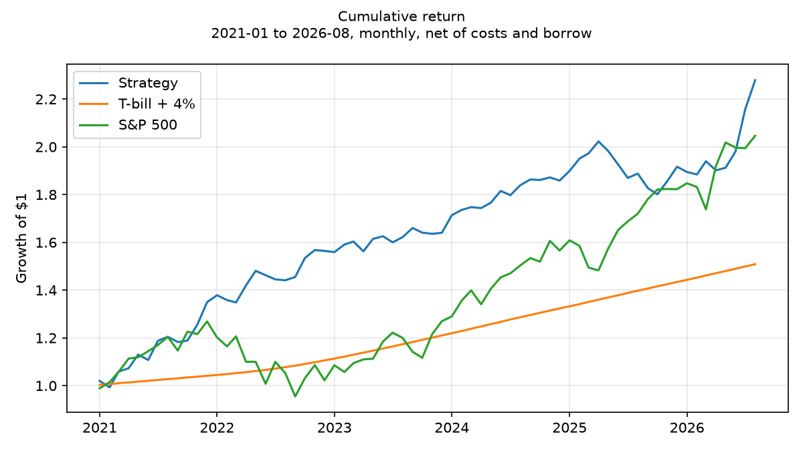

# Stochastic Pirates | McGill-FIAM 2026

**4th place at the 2026 McGill-FIAM Asset Management Hackathon.**

We built a market-neutral U.S. equity strategy around four research pods:
fundamentals, valuation, corporate events, and market dynamics. The final book
combines their stock rankings with a small company-graph overlay, then applies
explicit portfolio and risk constraints. Research agents propose ideas upstream;
fixed rules select and size the portfolio.

**Start here:** [Final presentation](docs/presentation/StochasticPirates.pdf) ·
[Strategy](docs/strategy.md) · [Results](docs/results.md) ·
[Research process](docs/research-process.md)

## Final results

January 2021-August 2026, 68 monthly observations. These are the final
presentation's **local Arcana-beta hybrid backtest**, net of modeled trading
and borrow costs. The matching aggregate evidence is in
[results/final_strategy](results/final_strategy/README.md).

| Metric | Strategy | T-bill + 4% hurdle | S&P 500 |
| :--- | ---: | ---: | ---: |
| CAGR | **15.65%** | 7.53% | 13.47% |
| Cumulative return | **127.89%** | 50.87% | 104.63% |
| Annualized volatility, from monthly returns | 9.54% | 0.56% | 15.10% |
| Maximum drawdown, month-end NAV | -10.96% | 0.00% | -24.77% |
| Sharpe, above T-bill | **1.22** | — | 0.70 |
| Information ratio vs hurdle | **0.80** | — | 0.44 |

A $1 billion starting endowment grows to $2.279 billion in this backtest.
The S&P 500 comparison uses the price index, excluding dividends.



Monthly net beta to the S&P 500 was -0.055; CAPM alpha was 12.36% per year
(HAC t-statistic 3.11). The long book generated most of the return. Shorts
provided protection in 2022 but hurt during the narrow and speculative rallies
of 2023 and 2025. [See annual returns, attribution, and limitations.](docs/results.md)

Daily held-return coverage and daily/monthly NAV reconciliation remain
incomplete. Daily volatility is therefore unverified, and the saved runtime
compliance receipt does **not** certify full submission readiness. The completed
competition result and the remaining research checks are separate facts.

## How the strategy works

| Pod | Economic question | Main signals |
| :--- | :--- | :--- |
| Fundamentals | How is the business performing? | Earnings surprises, disclosed analyst revisions, sales vs inventory, sales vs SG&A |
| Valuation | What is it worth? | Fair-value gaps and cash runway |
| Corporate events | What is changing? | Categories and frequency of 8-K filings |
| Market dynamics | How do stocks behave? | Boosted-tree rankings across 147 company characteristics |

Models use an expanding training window and two pre-test validation years,
with an annual refit. Information available at month-end forecasts the next
holding month. Available sleeve scores form a fixed blend, with a 5% graph
rank tilt where a graph forecast exists.

The portfolio holds **100 longs and 100 shorts**, rebalanced monthly. At
formation, sizing constrains three beta estimates to ±0.025, gross exposure
to 200%, net exposure to ±50%, and sector net exposure to ±20%. It also
enforces liquidity, short eligibility, position-size, and calendar-year
turnover rules. Cash/Treasury holdings are capped at 5% at rebalance.

The final discovery experiment proposed **144 sleeves and admitted none**.
An earlier research portfolio reported 321 candidate variants and 12
admissions; that is a separate experiment, described in
[the process notes](docs/research-process.md).

## Explore the repository

| Location | Contents |
| :--- | :--- |
| [final_v3/](final_v3/README.md) | Final strategy implementation; entrypoint `main.py` |
| [final_v2/](final_v2/README.md) | Earlier research platform and shared Carbon Arc MCP/OAuth transport; entrypoint `run.py` |
| [docs/](docs/README.md) | Strategy, process, data requirements, reproduction, and presentation |
| [results/final_strategy/](results/final_strategy/README.md) | Matching aggregate metrics, monthly returns, charts, and saved checks |
| [archive/](archive/README.md) | Earlier implementation and regression tests |
| [tools/carbon/](tools/README.md) | Historical Carbon Arc exploration and acquisition helpers |
| [data/](data/README.md), [external_data/](external_data/README.md) | Input specifications; source data are excluded |

## Run with your own authorized inputs

The public snapshot contains source and aggregate results. Competition data,
licensed I/B/E/S data, saved Arcana betas, trained models, and prediction
checkpoints are supplied separately. Reading the presentation and results
requires none of them.

Use Python 3.13 and install the recorded research environment:

```bash
python -m venv .venv
# Activate .venv for your shell.
python -m pip install -r requirements.txt
python final_v3/main.py --help
```

After providing the inputs in [the data guide](docs/data.md), run the fixed
baseline explicitly:

```bash
python final_v3/main.py --no-discovery --device cpu --data-dir data --external-file external_data/external.parquet --arcana-beta-file data/arcana/arcana_spy_beta_previous_holdings.csv --max-abs-beta 0.025 --output-dir final_v3/output
```

This command trains models and can take substantial time. CUDA is supported
with `--device cuda`. Frozen-checkpoint replay, input hash checks, and the
differences between a new run and the published backtest are documented in
[reproducing the strategy](docs/reproducibility.md).

`--official-only` removes the licensed analyst-revision sleeve;
`--no-arcana-beta` uses local beta constraints. Both change the experiment.
The application default remains agent-enabled; use `--no-discovery` for the
final fixed baseline. `--with-discovery` can call external research services.

## Publication

The current source tree excludes source data, credentials, internal instructions,
draft documents, vendor exports and local run artifacts. The original commit
history is retained; older commits still contain some excluded material.
See [the publication policy](docs/PUBLISHING.md).
